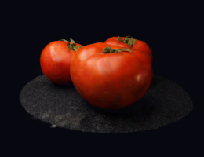

<!--
Copyright (c) 2026 Seth Kitchen, PE
SPDX-License-Identifier: PolyForm-Noncommercial-1.0.0
-->

# ThreeMojo

[](LICENSE)
[](https://mojolang.org)
[](https://github.com/SethKitchen/ThreeMojo/wiki/Coverage-tool)



Rendered by `examples/tomatoes.mojo`: a scan of three tomatoes, 445,409 Gaussian splats, that this project decodes from an SPZ file and draws on the CPU. The scan is ["Scan was created on my DIY automated rig."](https://superspl.at/scene/2826d2c0) by [Grail](https://superspl.at/user?id=grail), under [CC BY 4.0](https://creativecommons.org/licenses/by/4.0/). The scene is the one in the three.js example `webgpu_gaussian_splat`. The [C ABI and hosts](https://github.com/SethKitchen/ThreeMojo/wiki/C-ABI-and-hosts) page shows how to run it at a high frame rate in a window and in a browser.

ThreeMojo is a port of [three.js](https://threejs.org) to [Mojo](https://mojolang.org). It renders 3D scenes in software on the CPU, or on a GPU, and writes PNG files. The core CPU renderer uses the Mojo standard library. The optional GPU backend needs MAX.

The project exists to learn graphics and Mojo from first principles.

ThreeMojo implements the three.js features in the [feature checklist](#features), within each linked page's documented limits. Programs use Mojo APIs and CPU or MAX GPU execution. Existing JavaScript code and browser integrations need adaptation to this API and runtime.

## Install

Supported platforms: macOS on Apple Silicon, Linux on x86-64 or aarch64, and Windows through WSL 2. You need Python 3.9 or later, `git`, `make` and [uv](https://docs.astral.sh/uv/).

```bash
git clone https://github.com/SethKitchen/ThreeMojo.git
cd ThreeMojo
uv python install --no-bin 3.12.14
"$(uv python find --managed-python --no-project 3.12.14)" -m venv --without-pip --prompt ThreeMojo .venv
uv pip install "mojo==1.2.0"
uv pip install "max==26.7.0"      # optional: the GPU backend
```

[How to install](https://github.com/SethKitchen/ThreeMojo/wiki/How-to-install) covers WSL 2, the Metal toolchain and the editor setup.

## Start

```bash
make check-cpu                                            # format, lint, tests, docs
make animation                                            # gallery examples, into out/
make optimize-images                                      # losslessly compress tracked gallery PNGs
.venv/bin/mojo run -I . examples/cubes.mojo out/cubes.png
```

Then follow [Tutorial: render your first scene](https://github.com/SethKitchen/ThreeMojo/wiki/Tutorial-Render-your-first-scene).

## Documentation

The [wiki](https://github.com/SethKitchen/ThreeMojo/wiki) follows [Diátaxis](https://diataxis.fr). Tutorials teach. How-to guides solve one task. Reference pages describe each feature. Explanation pages say why the design is what it is.

The pages live in [`docs/wiki/`](docs/wiki) and are published to the wiki on every push to `main`. `make docs-check` enforces the [writing rules](https://github.com/SethKitchen/ThreeMojo/wiki/How-to-write-documentation).

## Features

A ticked item has a port, tests and documentation on the linked wiki page. Each item has a GitHub issue. The coverage badge states the required threshold, not the result for an unverified revision. Confirm a revision's results from its completed checks. See [Coverage tool](https://github.com/SethKitchen/ThreeMojo/wiki/Coverage-tool#limits) for known measurement limits.

The checklist covers three.js ports, project tools and extensions. A checked item records implementation within its linked page's limits. It does not establish complete upstream behavior or performance parity.

Some portable features remain partial, including [GLSL shaders](https://github.com/SethKitchen/ThreeMojo/wiki/Node-materials#the-subset), [volume materials](https://github.com/SethKitchen/ThreeMojo/wiki/Node-materials#what-is-not-ported) and [image formats](https://github.com/SethKitchen/ThreeMojo/wiki/Textures#what-is-not-ported). [Out of scope](#out-of-scope) lists excluded APIs and addons. Expand a dropdown to see implemented entries; open entries remain visible.

<!-- features -->
### Implemented three.js features

- [x] [Bounded GLSL source coverage](https://github.com/SethKitchen/ThreeMojo/wiki/Node-materials#the-subset): exact 32-bit unsigned scalars and vectors, explicit 2D texture gradients, and checked finite loops [#614](https://github.com/SethKitchen/ThreeMojo/issues/614)
- [x] [OpenEXR compression coverage](https://github.com/SethKitchen/ThreeMojo/wiki/Textures#hdr-images): PXR24 and DWA from three.js r180; B44 and B44A from r186 [#615](https://github.com/SethKitchen/ThreeMojo/issues/615)
- [x] [Raw ASTC in KTX2](https://github.com/SethKitchen/ThreeMojo/wiki/Textures#raw-astc): 4x4 and 6x6 UNORM, sRGB and SFLOAT from three.js r180 [#617](https://github.com/SethKitchen/ThreeMojo/issues/617)

### Navigation safety

<details>
<summary>Implemented: 1</summary>

- [x] [Finite navigation search budgets](https://github.com/SethKitchen/ThreeMojo/wiki/CARLA-agents#search-budgets): sparse node records, explicit work limits, and distinct exhaustion results [#479](https://github.com/SethKitchen/ThreeMojo/issues/479)

</details>

### Physics safety

- [ ] [Wider continuous collision](https://github.com/SethKitchen/ThreeMojo/wiki/Continuous-collision#supported-worlds): turning capsules, offset shapes, translating boxes and hulls, moving pairs and kinematic spheres work; turning boxes and hulls remain refused [#635](https://github.com/SethKitchen/ThreeMojo/issues/635)

- [x] [Canonical-to-visual humanoid fidelity](https://github.com/SethKitchen/ThreeMojo/wiki/Humanoid-fidelity): generated canonical SI parts and whole-body properties, versioned visual maps that refuse unsupported paths, and sealed bakes [#297](https://github.com/SethKitchen/ThreeMojo/issues/297)

<details>
<summary>Implemented: 8</summary>

- [x] [CCD walker benchmark](https://github.com/SethKitchen/ThreeMojo/wiki/Continuous-collision#performance-and-verification): 1 and 64 walkers or spinning spheres on 2,048 and 8,192 triangles, with per-body checks [#728](https://github.com/SethKitchen/ThreeMojo/issues/728)

- [x] [Owned physics query snapshots](https://github.com/SethKitchen/ThreeMojo/wiki/Physics-query-snapshots): frozen geometry, materials and capture-scoped historical owners, with unchanged live-world raycasts [#633](https://github.com/SethKitchen/ThreeMojo/issues/633)

- [x] [Conservative sphere/static-mesh CCD candidates](https://github.com/SethKitchen/ThreeMojo/wiki/Continuous-collision#performance-and-verification): immutable snapshot validation, bounded triangle queries and independent brute-force parity [#636](https://github.com/SethKitchen/ThreeMojo/issues/636)

- [x] [Sphere/static-mesh continuous collision](https://github.com/SethKitchen/ThreeMojo/wiki/Continuous-collision): opt-in analytic sweeps, bounded support, multiple impacts and transactional failure [#292](https://github.com/SethKitchen/ThreeMojo/issues/292)

- [x] [Static primitive index benchmark and design](https://github.com/SethKitchen/ThreeMojo/wiki/Physics#static-primitive-index-design): bounded snapshot experiments, allocation costs, exact contact/ray oracles and a deferred production ownership contract [#288](https://github.com/SethKitchen/ThreeMojo/issues/288)

- [x] [Tick-force restoration decision](https://github.com/SethKitchen/ThreeMojo/wiki/Tick-force-restoration): measured mixed-body CPU and allocation costs, with body-mode and ghost lifetime regressions [#287](https://github.com/SethKitchen/ThreeMojo/issues/287)

- [x] [Tires on moving supports](https://github.com/SethKitchen/ThreeMojo/wiki/CARLA-physics#moving-supports): relative contact velocity, shared support response and two-body effective mass [#296](https://github.com/SethKitchen/ThreeMojo/issues/296)

- [x] [Guarded body mass API](https://github.com/SethKitchen/ThreeMojo/wiki/Physics#change-a-bodys-motion-mode): value accessors, validated mode and inverse-tensor setters, and state-entry consistency checks [#554](https://github.com/SethKitchen/ThreeMojo/issues/554)

</details>

### Numerical range

<details>
<summary>Implemented: 2</summary>

- [x] [Exact adaptive convex hull predicates](https://github.com/SethKitchen/ThreeMojo/wiki/Geometry#convex-hull): original-coordinate orientation, exact tolerance comparisons and bounded extreme-range fallbacks [#538](https://github.com/SethKitchen/ThreeMojo/issues/538)

- [x] [Scale-safe norm consumers](https://github.com/SethKitchen/ThreeMojo/wiki/Norm-consumers): finite directions, angles, geometry normals and tangents, loader axes, lighting, and texture footprints across scalar ranges [#348](https://github.com/SethKitchen/ThreeMojo/issues/348)

</details>

### Numeric correctness

<details>
<summary>Implemented: 2</summary>

- [x] [Exact periodic remainders](https://github.com/SethKitchen/ThreeMojo/wiki/Math#periodic-scalar-helpers): finite binary reduction, strict Euclidean ranges, and range-safe positive pingpong periods [#603](https://github.com/SethKitchen/ThreeMojo/issues/603)

- [x] [Ray-query throughput](https://github.com/SethKitchen/ThreeMojo/wiki/Raycasting#bounds-query-precision-and-cost): exact component validation and a complete performance matrix with accepted current costs [#550](https://github.com/SethKitchen/ThreeMojo/issues/550)

</details>

### Project tools

<details>
<summary>Implemented: 70</summary>

- [x] [Coverage capture](https://github.com/SethKitchen/ThreeMojo/wiki/Coverage-tool#capture-scheduling-and-progress): `tools/coverage_io.mojo` captures one suite, reports a failed suite's last lines, and replays the captures [#761](https://github.com/SethKitchen/ThreeMojo/issues/761)

- [x] [Compiled coverage profile](https://github.com/SethKitchen/ThreeMojo/wiki/Coverage-tool#capture-scheduling-and-progress): `tools/coverage_hit_aot.mojo` builds a compiled capture and keeps the source path [#761](https://github.com/SethKitchen/ThreeMojo/issues/761)

- [x] [Coverage group deadline](https://github.com/SethKitchen/ThreeMojo/wiki/Coverage-tool#capture-scheduling-and-progress): `tools/coverage_group.mojo` gives every capture one deadline [#761](https://github.com/SethKitchen/ThreeMojo/issues/761)

- [x] [CARLA environment list](https://github.com/SethKitchen/ThreeMojo/wiki/CARLA-assets#the-carla-towns): `tools/carla_town_environment.mojo` writes each town's environment list [#761](https://github.com/SethKitchen/ThreeMojo/issues/761)

- [x] [CARLA town layout dump](https://github.com/SethKitchen/ThreeMojo/wiki/CARLA-assets#rebuild-the-town-packages): `tools/carla_town_layout.mojo` installs the layout mod and dumps each town [#761](https://github.com/SethKitchen/ThreeMojo/issues/761)

- [x] [CARLA vehicle export](https://github.com/SethKitchen/ThreeMojo/wiki/CARLA-assets#rebuild-the-vehicle-zips): `tools/carla_vehicle_export.mojo` exports each vehicle and merges its meshes [#761](https://github.com/SethKitchen/ThreeMojo/issues/761)

- [x] [CARLA environment record](https://github.com/SethKitchen/ThreeMojo/wiki/CARLA-assets#the-carla-towns): `tools/carla_environment_record.mojo` rounds each position to four decimal places [#761](https://github.com/SethKitchen/ThreeMojo/issues/761)

- [x] [CARLA town base color](https://github.com/SethKitchen/ThreeMojo/wiki/CARLA-assets#the-carla-towns): `tools/carla_town_albedo.mojo` reads a material's base color [#761](https://github.com/SethKitchen/ThreeMojo/issues/761)

- [x] [CARLA town picture materials](https://github.com/SethKitchen/ThreeMojo/wiki/CARLA-assets#the-carla-towns): `tools/carla_town_attach.mojo` adds a plain material and each picture material [#761](https://github.com/SethKitchen/ThreeMojo/issues/761)

- [x] [CARLA far building picture](https://github.com/SethKitchen/ThreeMojo/wiki/CARLA-assets#the-carla-towns): `tools/carla_town_bake.mojo` draws a far building and writes its picture [#761](https://github.com/SethKitchen/ThreeMojo/issues/761)

- [x] [CARLA far tree picture](https://github.com/SethKitchen/ThreeMojo/wiki/CARLA-assets#the-carla-towns): `tools/carla_town_tree.mojo` draws a far tree and writes its picture [#761](https://github.com/SethKitchen/ThreeMojo/issues/761)

- [x] [CARLA town mesh level](https://github.com/SethKitchen/ThreeMojo/wiki/CARLA-assets#the-carla-towns): `tools/carla_town_lower.mojo` lowers one mesh or keeps its leaf cards [#761](https://github.com/SethKitchen/ThreeMojo/issues/761)

- [x] [CARLA town copy groups](https://github.com/SethKitchen/ThreeMojo/wiki/CARLA-assets#the-carla-towns): `tools/carla_town_group.mojo` places each copy and merges one tile [#761](https://github.com/SethKitchen/ThreeMojo/issues/761)

- [x] [CARLA town mesh plan](https://github.com/SethKitchen/ThreeMojo/wiki/CARLA-assets#the-carla-towns): `tools/carla_town_plan.mojo` chooses which meshes stay and which far level each uses [#761](https://github.com/SethKitchen/ThreeMojo/issues/761)

- [x] [CARLA town package writer](https://github.com/SethKitchen/ThreeMojo/wiki/CARLA-assets#the-carla-towns): `tools/carla_town_write.mojo` writes the loose glTF and packs the binary glTF [#761](https://github.com/SethKitchen/ThreeMojo/issues/761)

- [x] [CARLA vehicle package](https://github.com/SethKitchen/ThreeMojo/wiki/CARLA-assets#rebuild-the-vehicle-zips): `tools/carla_gltf_package.mojo` writes one vehicle glTF package [#761](https://github.com/SethKitchen/ThreeMojo/issues/761)

- [x] [CARLA material rebuild](https://github.com/SethKitchen/ThreeMojo/wiki/CARLA-assets#rebuild-the-vehicle-zips): `tools/carla_gltf_rebuild.mojo` applies each material and writes its textures [#761](https://github.com/SethKitchen/ThreeMojo/issues/761)

- [x] [Packaged CARLA texture files](https://github.com/SethKitchen/ThreeMojo/wiki/CARLA-assets#rebuild-the-vehicle-zips): `tools/carla_texture_store.mojo` writes each color and cut-out picture [#761](https://github.com/SethKitchen/ThreeMojo/issues/761)

- [x] [Town mesh simplification](https://github.com/SethKitchen/ThreeMojo/wiki/CARLA-assets#the-carla-towns): `tools/carla_town_simplify.mojo` collapses a near mesh and welds a far mesh [#761](https://github.com/SethKitchen/ThreeMojo/issues/761)

- [x] [Vehicle mesh decimation](https://github.com/SethKitchen/ThreeMojo/wiki/CARLA-assets#rebuild-the-vehicle-zips): `tools/carla_gltf_decimate.mojo` simplifies each free vehicle part [#761](https://github.com/SethKitchen/ThreeMojo/issues/761)

- [x] [Packaged CARLA texture pixels](https://github.com/SethKitchen/ThreeMojo/wiki/CARLA-assets#rebuild-the-vehicle-zips): `tools/carla_image_pack.mojo` builds each color, cut-out and tree picture [#761](https://github.com/SethKitchen/ThreeMojo/issues/761)

- [x] [UModel package class for a CARLA vehicle](https://github.com/SethKitchen/ThreeMojo/wiki/CARLA-assets#rebuild-the-vehicle-zips): `tools/carla_umodel_class.mojo` reads the class UModel lists for a package [#761](https://github.com/SethKitchen/ThreeMojo/issues/761)

- [x] [Pillow image reads for CARLA textures](https://github.com/SethKitchen/ThreeMojo/wiki/CARLA-assets#rebuild-the-vehicle-zips): `tools/carla_image.mojo` reads a PNG or a JPEG into the pixels Pillow reads. It turns each byte into unit color [#761](https://github.com/SethKitchen/ThreeMojo/issues/761)

- [x] [Pillow JPEG files for CARLA textures](https://github.com/SethKitchen/ThreeMojo/wiki/CARLA-assets#rebuild-the-vehicle-zips): `tools/carla_jpeg.mojo` writes a JPEG with Pillow's libjpeg settings [#761](https://github.com/SethKitchen/ThreeMojo/issues/761)

- [x] [Pillow PNG files for CARLA textures](https://github.com/SethKitchen/ThreeMojo/wiki/CARLA-assets#rebuild-the-vehicle-zips): `tools/carla_png.mojo` writes an optimized PNG with Pillow's row filters [#761](https://github.com/SethKitchen/ThreeMojo/issues/761)

- [x] [Quadric mesh collapses](https://github.com/SethKitchen/ThreeMojo/wiki/CARLA-assets#rebuild-the-vehicle-zips): `tools/carla_simplify.mojo` records the same collapses as fast-simplification and replays them [#761](https://github.com/SethKitchen/ThreeMojo/issues/761)

- [x] [Town triangle share](https://github.com/SethKitchen/ThreeMojo/wiki/CARLA-assets#the-carla-towns): `tools/carla_town_share.mojo` keeps one grass blade in ten and shares each kind's cap [#761](https://github.com/SethKitchen/ThreeMojo/issues/761)

- [x] [CARLA town package](https://github.com/SethKitchen/ThreeMojo/wiki/CARLA-assets#rebuild-the-town-packages): `tools/carla_town_build.mojo` builds one town package from its layout [#761](https://github.com/SethKitchen/ThreeMojo/issues/761)

- [x] [Format argument batches](https://github.com/SethKitchen/ThreeMojo/wiki/How-to-run-the-checks#run-the-tool-tests): `tools/check_format_arguments.mojo` checks 1789 formatter paths [#761](https://github.com/SethKitchen/ThreeMojo/issues/761)

- [x] [Private test directory](https://github.com/SethKitchen/ThreeMojo/wiki/How-to-run-the-checks#run-one-test-suite): the coverage capture and the suite runner keep a private temporary root [#761](https://github.com/SethKitchen/ThreeMojo/issues/761)

- [x] [Mojo suite key](https://github.com/SethKitchen/ThreeMojo/wiki/How-to-run-the-checks#rebuild-the-project-tools): `tools/suite_key.mojo` keys the suite stamps [#761](https://github.com/SethKitchen/ThreeMojo/issues/761)

- [x] [Town build summary](https://github.com/SethKitchen/ThreeMojo/wiki/CARLA-assets#rebuild-the-town-packages): `tools/carla_town_build.mojo` prints each town's triangle counts and package size [#761](https://github.com/SethKitchen/ThreeMojo/issues/761)

- [x] [Vehicle package command](https://github.com/SethKitchen/ThreeMojo/wiki/CARLA-assets#rebuild-the-vehicle-zips): `tools/carla_gltf_package.mojo` writes one vehicle package [#761](https://github.com/SethKitchen/ThreeMojo/issues/761)

- [x] [Synthetic town package](https://github.com/SethKitchen/ThreeMojo/wiki/CARLA-assets#test-the-town-exporter): `tests/test_carla_town_package.mojo` checks colors, slots, a repeated build, and a hidden grid cell [#761](https://github.com/SethKitchen/ThreeMojo/issues/761)

- [x] [Masked cutoff pictures](https://github.com/SethKitchen/ThreeMojo/wiki/CARLA-assets#test-the-town-exporter): `tests/test_carla_town_cutoff.mojo` keeps a low cutoff and clears a high cutoff [#761](https://github.com/SethKitchen/ThreeMojo/issues/761)

- [x] [Python town bake removal](https://github.com/SethKitchen/ThreeMojo/wiki/CARLA-assets#test-the-town-exporter): the Python files `build_towns.py`, `carla_gltf_fix.py`, and `test_build_towns.py` are removed [#761](https://github.com/SethKitchen/ThreeMojo/issues/761)

- [x] [Neutral CARLA texture plan](https://github.com/SethKitchen/ThreeMojo/wiki/CARLA-assets#the-carla-towns): `tools/carla_texture_plan.mojo` names a neutral texture and chooses its fitted size [#761](https://github.com/SethKitchen/ThreeMojo/issues/761)

- [x] [Vehicle body and glass](https://github.com/SethKitchen/ThreeMojo/wiki/CARLA-assets#rebuild-the-vehicle-zips): `tools/carla_vehicle_pick.mojo` chooses the largest skeletal mesh and the static glass [#761](https://github.com/SethKitchen/ThreeMojo/issues/761)

- [x] [Cut-out channel of a foliage mask](https://github.com/SethKitchen/ThreeMojo/wiki/CARLA-assets#rebuild-the-vehicle-zips): `tools/carla_mask_channel.mojo` chooses the mask channel with the most extreme samples [#761](https://github.com/SethKitchen/ThreeMojo/issues/761)

- [x] [Pillow image resize for CARLA textures](https://github.com/SethKitchen/ThreeMojo/wiki/CARLA-assets#rebuild-the-vehicle-zips): `tools/carla_image_resize.mojo` resizes textures with Pillow's Lanczos and box filters and stores unit color as bytes [#761](https://github.com/SethKitchen/ThreeMojo/issues/761)

- [x] [Tile of a placed town copy](https://github.com/SethKitchen/ThreeMojo/wiki/CARLA-assets#the-carla-towns): `tools/carla_town_place.mojo` chooses the tile from the copy's origin [#761](https://github.com/SethKitchen/ThreeMojo/issues/761)

- [x] [Simplification target for a CARLA mesh](https://github.com/SethKitchen/ThreeMojo/wiki/CARLA-assets#the-carla-towns): `tools/carla_simplify_target.mojo` chooses how many triangles a simplified mesh keeps [#761](https://github.com/SethKitchen/ThreeMojo/issues/761)

- [x] [Collapse map for a simplified mesh](https://github.com/SethKitchen/ThreeMojo/wiki/CARLA-assets#rebuild-the-vehicle-zips): `tools/carla_collapse_map.mojo` keeps the first corner that fell into each new one and copies its texture values [#761](https://github.com/SethKitchen/ThreeMojo/issues/761)

- [x] [Nearest triangles for a simplified town face](https://github.com/SethKitchen/ThreeMojo/wiki/CARLA-assets#the-carla-towns): `tools/carla_town_near.mojo` finds the original triangles nearest that face's center [#761](https://github.com/SethKitchen/ThreeMojo/issues/761)

- [x] [Triangle choice for a simplified town face](https://github.com/SethKitchen/ThreeMojo/wiki/CARLA-assets#the-carla-towns): `tools/carla_town_choose.mojo` picks the original triangle that face reads [#761](https://github.com/SethKitchen/ThreeMojo/issues/761)

- [x] [C ABI host tools in Mojo](https://github.com/SethKitchen/ThreeMojo/wiki/C-ABI-and-hosts#run-it): frame compare, wasm32 retarget, the isolated page server and the Metal string run as Mojo [#761](https://github.com/SethKitchen/ThreeMojo/issues/761)

- [x] [Native test fixtures in Mojo](https://github.com/SethKitchen/ThreeMojo/wiki/How-to-run-the-checks#run-one-test-suite): `make test-cpu` links the C fixtures with `tools/native_test_support.mojo` [#761](https://github.com/SethKitchen/ThreeMojo/issues/761)

- [x] [Compiled coverage profile check in Mojo](https://github.com/SethKitchen/ThreeMojo/wiki/How-to-measure-coverage#choose-the-capture-profile): `tools/check_coverage_hit_profile.mojo` checks cold and warm phase records [#761](https://github.com/SethKitchen/ThreeMojo/issues/761)

- [x] [Lint and format log in Mojo](https://github.com/SethKitchen/ThreeMojo/wiki/How-to-run-the-checks#rebuild-the-project-tools): `tools/shell_log.mojo` writes the lint lines and the format run id [#761](https://github.com/SethKitchen/ThreeMojo/issues/761)

- [x] [Coverage protocol check in Mojo](https://github.com/SethKitchen/ThreeMojo/wiki/Coverage-tool#evaluation-protocol): `tools/check_coverage_protocol.mojo` checks vectors, pipes, and write faults [#761](https://github.com/SethKitchen/ThreeMojo/issues/761)

- [x] [Coverage grouping checker in Mojo](https://github.com/SethKitchen/ThreeMojo/wiki/Coverage-tool#compiler-hang): `tools/check_coverage_grouping.mojo` compares the Boolean, custom-truth, and Optional fixtures [#761](https://github.com/SethKitchen/ThreeMojo/issues/761)

- [x] [CI planner in Mojo](https://github.com/SethKitchen/ThreeMojo/wiki/How-to-run-the-checks#rebuild-the-project-tools): `tools/ci_scope.mojo` selects, runs and checks the hosted CI jobs with byte-identical plans [#769](https://github.com/SethKitchen/ThreeMojo/issues/769)

- [x] [Build tools in Mojo](https://github.com/SethKitchen/ThreeMojo/wiki/How-to-run-the-checks#rebuild-the-project-tools): the Makefile selects, splits and keys the checks with Mojo programs that it builds once [#767](https://github.com/SethKitchen/ThreeMojo/issues/767)

- [x] [Fixture verifiers in Mojo](https://github.com/SethKitchen/ThreeMojo/wiki/How-to-run-the-checks#verify-generated-fixtures): the fixture manifest check and the pinned Node runtime verifier run as Mojo with shared helpers [#764](https://github.com/SethKitchen/ThreeMojo/issues/764)

- [x] [Negative-fixture checker in Mojo](https://github.com/SethKitchen/ThreeMojo/wiki/How-to-run-the-checks#regenerate-negative-diagnostics): `tools/compile_fail.mojo` with a Mojo process helper replaces the Python checker; the manifest output is byte-identical [#763](https://github.com/SethKitchen/ThreeMojo/issues/763)

- [x] [PNG optimizer in Mojo](https://github.com/SethKitchen/ThreeMojo/wiki/Image-files#recompress-a-png): lossless PNG and APNG recompression with no Python, part of porting the project tools [#762](https://github.com/SethKitchen/ThreeMojo/issues/762)

- [x] [Durable CARLA asset hosting](https://github.com/SethKitchen/ThreeMojo/wiki/CARLA-assets#publish-the-converted-archives): Google Drive hosts the archives, and a public download of all 47 is verified [#309](https://github.com/SethKitchen/ThreeMojo/issues/309)

- [x] [Wiki link check](https://github.com/SethKitchen/ThreeMojo/wiki/How-to-write-documentation#check-the-rules): `make docs-check` refuses wiki links to pages or headings that do not exist [#687](https://github.com/SethKitchen/ThreeMojo/issues/687)

- [x] [Decode failure early stop](https://github.com/SethKitchen/ThreeMojo/wiki/Image-decode-queue#ordering-and-failure): monotonic stop, joined claimed work and ordered errors, qualified on main [#668](https://github.com/SethKitchen/ThreeMojo/issues/668)

- [x] [Converted face and hair input contract](https://github.com/SethKitchen/ThreeMojo/wiki/Converted-assets): bounded ingestion, pinned upstream inputs and exact production reproduction [#303](https://github.com/SethKitchen/ThreeMojo/issues/303)

- [x] [Bounded image decode scheduling](https://github.com/SethKitchen/ThreeMojo/wiki/Image-decode-queue): shared dynamic workers, ordered results, bounded active staging, and atomic cache publication [#505](https://github.com/SethKitchen/ThreeMojo/issues/505)

- [x] [Portable asset and test roots](https://github.com/SethKitchen/ThreeMojo/wiki/How-to-run-the-checks#run-one-test-suite): explicit asset roots, isolated direct-run fixtures, and subprocess ownership checks [#310](https://github.com/SethKitchen/ThreeMojo/issues/310)

- [x] [Pinned fixture runtimes](https://github.com/SethKitchen/ThreeMojo/wiki/How-to-run-the-checks#verify-generated-fixtures): exact VTK and sRGB regeneration without replacing accepted results [#497](https://github.com/SethKitchen/ThreeMojo/issues/497)

- [x] [Reviewed negative diagnostics](https://github.com/SethKitchen/ThreeMojo/wiki/How-to-run-the-checks#regenerate-negative-diagnostics): explicit selected-fixture updates preserve strict checks and replace expectations atomically [#504](https://github.com/SethKitchen/ThreeMojo/issues/504)

- [x] [Loop body indentation](https://github.com/SethKitchen/ThreeMojo/wiki/Coverage-tool#loop-body-indentation): coverage probes use actual body indentation and preserve loop-else control flow [#544](https://github.com/SethKitchen/ThreeMojo/issues/544)

- [x] [Trait default coverage](https://github.com/SethKitchen/ThreeMojo/wiki/Coverage-tool#trait-defaults-and-generated-names): executable inherited method bodies have line and decision probes [#540](https://github.com/SethKitchen/ThreeMojo/issues/540)

- [x] [Collision-safe coverage probes](https://github.com/SethKitchen/ThreeMojo/wiki/Coverage-tool#trait-defaults-and-generated-names): helper aliases and loop counters use names absent from the source [#541](https://github.com/SethKitchen/ThreeMojo/issues/541)

- [x] [Complete coverage vectors](https://github.com/SethKitchen/ThreeMojo/wiki/Coverage-tool#evaluation-protocol): recursion, exceptions and concurrent calls retain separate evaluation operands [#385](https://github.com/SethKitchen/ThreeMojo/issues/385)

- [x] [Grouped coverage conditions](https://github.com/SethKitchen/ThreeMojo/wiki/Coverage-tool#grouped-conditions): leaf-condition and MC/DC probes retain Boolean grouping and short-circuit order [#535](https://github.com/SethKitchen/ThreeMojo/issues/535)

- [x] [Custom compound truth tests](https://github.com/SethKitchen/ThreeMojo/wiki/Coverage-tool#truth-conversion-limit): the original supported same-type forms remain enabled, with identity-preserving atomic negation. [Identity-sensitive selection remains a known limitation](https://github.com/SethKitchen/ThreeMojo/wiki/Coverage-tool#known-identity-sensitive-selection-limitation); arbitrary custom truth support is not yet complete [#560](https://github.com/SethKitchen/ThreeMojo/issues/560)

</details>

### Scene

<details>
<summary>Ported: 16</summary>

- [x] [Scene JSON for every geometry type](https://github.com/SethKitchen/ThreeMojo/wiki/Scene-JSON#geometry): all nineteen parametric types, the shapes library, curve JSON, and lone geometry and material documents [#185](https://github.com/SethKitchen/ThreeMojo/issues/185)
- [x] [Scene graph](https://github.com/SethKitchen/ThreeMojo/wiki/Scene-graph): `Object3D`, `Scene`, parent and child transforms [#1](https://github.com/SethKitchen/ThreeMojo/issues/1)
- [x] [Edit the scene graph](https://github.com/SethKitchen/ThreeMojo/wiki/Scene-graph#edit-the-graph): reparent, attach, remove, clone and traverse nodes; world-space queries; Group and userData in scene JSON. [#165](https://github.com/SethKitchen/ThreeMojo/issues/165)
- [x] [Quaternion and Euler rotations](https://github.com/SethKitchen/ThreeMojo/wiki/Rotations): six Euler orders, `rotate_x`, `rotate_y`, `rotate_z`, `look_at`, `slerp` [#2](https://github.com/SethKitchen/ThreeMojo/issues/2)
- [x] [PerspectiveCamera](https://github.com/SethKitchen/ThreeMojo/wiki/Cameras#perspectivecamera) [#3](https://github.com/SethKitchen/ThreeMojo/issues/3)
- [x] [OrthographicCamera](https://github.com/SethKitchen/ThreeMojo/wiki/Cameras#orthographiccamera) [#4](https://github.com/SethKitchen/ThreeMojo/issues/4)
- [x] [Camera on a scene node](https://github.com/SethKitchen/ThreeMojo/wiki/Cameras#attach-a-camera-to-a-node): `attach`, orbit with a pivot [#5](https://github.com/SethKitchen/ThreeMojo/issues/5)
- [x] [CubeCamera](https://github.com/SethKitchen/ThreeMojo/wiki/Cameras#cubecamera): six faces rendered from one point into a cube texture, with layers to hide the mirror [#6](https://github.com/SethKitchen/ThreeMojo/issues/6). [Cube capture sampling](https://github.com/SethKitchen/ThreeMojo/wiki/Renderer#cube-capture-sampling): renderer-owned supersampling for byte faces, target-owned samples for layered captures [#397](https://github.com/SethKitchen/ThreeMojo/issues/397)
- [x] [ArrayCamera and StereoCamera](https://github.com/SethKitchen/ThreeMojo/wiki/Cameras#arraycamera): cameras drawing into rectangles of one image, and two eyes skewed to converge at a focus [#7](https://github.com/SethKitchen/ThreeMojo/issues/7)
- [x] [Fog and FogExp2](https://github.com/SethKitchen/ThreeMojo/wiki/Fog): `scene.fog`, a linear or an exponential veil by camera-space depth, mixed in linear light on both rasterizers [#8](https://github.com/SethKitchen/ThreeMojo/issues/8)
- [x] [Scene background and environment](https://github.com/SethKitchen/ThreeMojo/wiki/Scene-graph#background-and-environment): a color, a texture or a cube texture behind everything, and a cube texture materials reflect as `SCENE_ENVIRONMENT` [#9](https://github.com/SethKitchen/ThreeMojo/issues/9)
- [x] [Layers](https://github.com/SethKitchen/ThreeMojo/wiki/Scene-graph#layers): a bit mask on nodes and cameras that the renderer filters meshes by [#10](https://github.com/SethKitchen/ThreeMojo/issues/10)
- [x] [Clock](https://github.com/SethKitchen/ThreeMojo/wiki/Units#clock): elapsed and delta time as Durations, from a monotonic counter [#11](https://github.com/SethKitchen/ThreeMojo/issues/11)
- [x] [Object3D visibility, names, traversal and render order](https://github.com/SethKitchen/ThreeMojo/wiki/Scene-graph#visibility-names-and-render-order): a hidden node hides its subtree, and render order sorts before depth [#103](https://github.com/SethKitchen/ThreeMojo/issues/103)
- [x] [Clipping planes](https://github.com/SethKitchen/ThreeMojo/wiki/Renderer#clipping-planes): the renderer's planes and each material's own, union or intersection, cut before projection so both rasterizers agree [#104](https://github.com/SethKitchen/ThreeMojo/issues/104)
- [x] [Camera API and raycast hit data](https://github.com/SethKitchen/ThreeMojo/wiki/Cameras#view-offset): zoom, film, focal length and view offset, and raycast uv, face, barycoord and point-on-line data. [#172](https://github.com/SethKitchen/ThreeMojo/issues/172)

</details>

### Geometry


<details>
<summary>Ported: 27</summary>

- [x] [Procedural generators](https://github.com/SethKitchen/ThreeMojo/wiki/Procedural-generators): seeded city with skyscrapers, sidewalks, street furniture, cars and pedestrians, forest, terrain and tree generators [#254](https://github.com/SethKitchen/ThreeMojo/issues/254). Scale-safe tree frames and checked output ranges [#448](https://github.com/SethKitchen/ThreeMojo/issues/448)
- [x] [Sculptor, SculptorMesh, SculptorTools and SculptorUtils](https://github.com/SethKitchen/ThreeMojo/wiki/Sculptor): brush, inflate, smooth, flatten and the other strokes, from a ray or a pointer, with adaptive topology [#255](https://github.com/SethKitchen/ThreeMojo/issues/255). [Minimum world scale](https://github.com/SethKitchen/ThreeMojo/wiki/Sculptor#minimum-world-scale) [#458](https://github.com/SethKitchen/ThreeMojo/issues/458)
- [x] [LoftGeometry, WireframeGeometry2, ClippingGroup and more](https://github.com/SethKitchen/ThreeMojo/wiki/Lofts-and-clipping-groups): lofts, wide wireframes, clipping groups on both backends, path helpers, kelvin colors, clip files and cube depth [#256](https://github.com/SethKitchen/ThreeMojo/issues/256)
- [x] [RollerCoaster, TubePainter, ConvexObjectBreaker, Hilbert and Gosper curves, UVsDebug, frameCorners](https://github.com/SethKitchen/ThreeMojo/wiki/Geometry-addons#roller-coaster): track geometry, tube strokes, convex breaking, space-filling curves and UV images [#197](https://github.com/SethKitchen/ThreeMojo/issues/197)
- [x] [Shapes and extrusions in three.js's order](https://github.com/SethKitchen/ThreeMojo/wiki/Geometry#how-it-is-cut-up): earcut with holes, and three.js's vertex and triangle order for ShapeGeometry and ExtrudeGeometry [#215](https://github.com/SethKitchen/ThreeMojo/issues/215)
- [x] [Whole shape-hole boundaries](https://github.com/SethKitchen/ThreeMojo/wiki/Geometry#what-is-refused): reject crossings, touching contours and nested holes before triangulation or extrusion [#490](https://github.com/SethKitchen/ThreeMojo/issues/490)
- [x] [Box segments, partial spheres, shape arrays and UVGenerator](https://github.com/SethKitchen/ThreeMojo/wiki/Geometry#box): segmented boxes, sphere parts, shape lists and custom UV generators [#184](https://github.com/SethKitchen/ThreeMojo/issues/184)
- [x] [BufferGeometry transforms, draw range and normalized integer attributes](https://github.com/SethKitchen/ThreeMojo/wiki/Geometry#transforms): transforms, a draw range every pass honors, and seven typed arrays [#186](https://github.com/SethKitchen/ThreeMojo/issues/186)
- [x] [BufferGeometry and BufferAttribute](https://github.com/SethKitchen/ThreeMojo/wiki/Geometry) [#12](https://github.com/SethKitchen/ThreeMojo/issues/12)
- [x] [Geometry addons](https://github.com/SethKitchen/ThreeMojo/wiki/Geometry-addons): teapot, box lines, modifiers, BufferGeometryUtils, MikkTSpace tangents, SceneUtils, NURBS and named curves. [#180](https://github.com/SethKitchen/ThreeMojo/issues/180)
- [x] [BoxGeometry](https://github.com/SethKitchen/ThreeMojo/wiki/Geometry#box) [#13](https://github.com/SethKitchen/ThreeMojo/issues/13)
- [x] [SphereGeometry](https://github.com/SethKitchen/ThreeMojo/wiki/Geometry#sphere) [#14](https://github.com/SethKitchen/ThreeMojo/issues/14)
- [x] [PlaneGeometry](https://github.com/SethKitchen/ThreeMojo/wiki/Geometry#plane) [#15](https://github.com/SethKitchen/ThreeMojo/issues/15)
- [x] [CircleGeometry and RingGeometry](https://github.com/SethKitchen/ThreeMojo/wiki/Geometry#circle): pie slices and arcs with a start angle and a sweep [#16](https://github.com/SethKitchen/ThreeMojo/issues/16)
- [x] [CylinderGeometry and ConeGeometry](https://github.com/SethKitchen/ThreeMojo/wiki/Geometry#cylinder): frustums, pipes and sections, with caps that match three.js [#17](https://github.com/SethKitchen/ThreeMojo/issues/17)
- [x] [TorusGeometry and TorusKnotGeometry](https://github.com/SethKitchen/ThreeMojo/wiki/Geometry#torus): a tube around a circle, or around a p, q knot [#18](https://github.com/SethKitchen/ThreeMojo/issues/18)
- [x] [Polyhedron geometries: Icosahedron, Octahedron, Tetrahedron, Dodecahedron](https://github.com/SethKitchen/ThreeMojo/wiki/Geometry#polyhedra): the four regular solids and any polyhedron, cut toward a sphere by detail [#19](https://github.com/SethKitchen/ThreeMojo/issues/19)
- [x] [CapsuleGeometry](https://github.com/SethKitchen/ThreeMojo/wiki/Geometry#capsule): a cylinder with hemisphere caps and exact normals [#20](https://github.com/SethKitchen/ThreeMojo/issues/20)
- [x] [LatheGeometry and TubeGeometry](https://github.com/SethKitchen/ThreeMojo/wiki/Geometry#lathe): a profile revolved, and a tube swept along a path of points with three.js's frames [#21](https://github.com/SethKitchen/ThreeMojo/issues/21)
- [x] [ShapeGeometry and ExtrudeGeometry](https://github.com/SethKitchen/ThreeMojo/wiki/Geometry#shape): a drawn outline with holes cut into triangles by ear clipping, and given thickness with a bevel [#22](https://github.com/SethKitchen/ThreeMojo/issues/22)
- [x] [Parametric, convex, decal and rounded-box geometries](https://github.com/SethKitchen/ThreeMojo/wiki/Geometry#parametric): parametric surfaces, quickhull convex hulls, decals clipped to a projector box, and rounded boxes [#115](https://github.com/SethKitchen/ThreeMojo/issues/115)
- [x] [Extrude a shape along a path](https://github.com/SethKitchen/ThreeMojo/wiki/Geometry#along-a-path): a shape swept along a 3D curve in its Frenet frames [#113](https://github.com/SethKitchen/ThreeMojo/issues/113)
- [x] [EdgesGeometry and WireframeGeometry](https://github.com/SethKitchen/ThreeMojo/wiki/Geometry#edges-and-wireframes): a surface read back as the lines of its edges, welded by position first [#23](https://github.com/SethKitchen/ThreeMojo/issues/23)
- [x] [computeVertexNormals and bounding volumes](https://github.com/SethKitchen/ThreeMojo/wiki/Geometry#buffergeometry): area-weighted normals, a bounding box and a bounding sphere on any geometry [#24](https://github.com/SethKitchen/ThreeMojo/issues/24)
- [x] [BufferGeometryUtils: merge, non-indexed, merge vertices, tangents, center](https://github.com/SethKitchen/ThreeMojo/wiki/Geometry#merge-weld-and-tangents): merge geometries, weld vertices, creased normals, non-indexed copies, centering and tangents with handedness [#110](https://github.com/SethKitchen/ThreeMojo/issues/110)
- [x] [TextGeometry and FontLoader](https://github.com/SethKitchen/ThreeMojo/wiki/Geometry#text): typeface.js fonts laid out as shapes with holes and extruded, as in three.js [#114](https://github.com/SethKitchen/ThreeMojo/issues/114)
- [x] [Interleaved buffers and InstancedBufferGeometry](https://github.com/SethKitchen/ThreeMojo/wiki/Geometry#interleaved-buffers): attributes sharing one strided array, and instanced geometry drawn per instance with offsets and colors [#111](https://github.com/SethKitchen/ThreeMojo/issues/111)

</details>

### Objects


<details>
<summary>Ported: 15</summary>

- [x] [Gaussian splats](https://github.com/SethKitchen/ThreeMojo/wiki/Gaussian-splats): the GaussianSplat object drawn alike by both rasterizers, and the SPLAT, KSPLAT, SPZ, splat PLY and KHR_gaussian_splatting glTF loaders. Scene draw ordering, viewport projection, sparse glTF attributes and node placement [#247](https://github.com/SethKitchen/ThreeMojo/issues/247)
- [x] [MorphAnimMesh, MorphBlendMesh, MD2Character and Gyroscope](https://github.com/SethKitchen/ThreeMojo/wiki/Animated-objects): blended morph flip-books, Quake II characters, and a node that keeps its turn [#196](https://github.com/SethKitchen/ThreeMojo/issues/196)
- [x] [Skeleton, morph, batch and LOD tools](https://github.com/SethKitchen/ThreeMojo/wiki/Skinning#skeleton-tools): clone and retarget, CCD IK, uncapped morphs, batch deletion and sorting, any node as a level [#181](https://github.com/SethKitchen/ThreeMojo/issues/181)
- [x] [Scene objects](https://github.com/SethKitchen/ThreeMojo/wiki/Scene-objects): Reflector, Refractor, two waters, Sky, lens flare, marching cubes, grounded skybox and shadow mesh [#177](https://github.com/SethKitchen/ThreeMojo/issues/177)
- [x] [Multi-material meshes](https://github.com/SethKitchen/ThreeMojo/wiki/Meshes-and-assets#several-materials): geometry groups drawn with a material list by both rasterizers, the raycaster, loaders, exporters and SceneUtils [#167](https://github.com/SethKitchen/ThreeMojo/issues/167)
- [x] [Mesh, with geometry, material and texture stores](https://github.com/SethKitchen/ThreeMojo/wiki/Meshes-and-assets) [#25](https://github.com/SethKitchen/ThreeMojo/issues/25)
- [x] [Line, LineLoop and LineSegments](https://github.com/SethKitchen/ThreeMojo/wiki/Lines): points joined by one-pixel strokes, walked by one rule both backends read [#26](https://github.com/SethKitchen/ThreeMojo/issues/26)
- [x] [Points](https://github.com/SethKitchen/ThreeMojo/wiki/Points-and-sprites#points): vertices drawn as squares of pixels, sized by distance, covered by one rule both backends read [#27](https://github.com/SethKitchen/ThreeMojo/issues/27)
- [x] [Sprite](https://github.com/SethKitchen/ThreeMojo/wiki/Points-and-sprites#sprites): a square that always faces the camera, built in camera space and drawn as two triangles [#28](https://github.com/SethKitchen/ThreeMojo/issues/28)
- [x] [InstancedMesh and BatchedMesh](https://github.com/SethKitchen/ThreeMojo/wiki/Meshes-and-assets#instancedmesh): one geometry, or one geometry per instance, at many transforms under one node, culled instance by instance [#29](https://github.com/SethKitchen/ThreeMojo/issues/29)
- [x] [SkinnedMesh, Bone and Skeleton](https://github.com/SethKitchen/ThreeMojo/wiki/Skinning): bones that are scene nodes, and a skeleton saying how far each has moved since the bind [#30](https://github.com/SethKitchen/ThreeMojo/issues/30)
- [x] [LOD](https://github.com/SethKitchen/ThreeMojo/wiki/Meshes-and-assets#lod): one of several objects under a node, picked by the camera's distance before each frame, with hysteresis [#31](https://github.com/SethKitchen/ThreeMojo/issues/31)
- [x] [Per-instance colors](https://github.com/SethKitchen/ThreeMojo/wiki/Meshes-and-assets#instance-colors): a color per instance of an instanced or batched mesh that multiplies the material color [#112](https://github.com/SethKitchen/ThreeMojo/issues/112)
- [x] [Raycasting lines, points, sprites and skinned meshes](https://github.com/SethKitchen/ThreeMojo/wiki/Raycasting#lines-points-and-sprites): skinned meshes picked where the bones carry them, with three.js's line and point thresholds [#117](https://github.com/SethKitchen/ThreeMojo/issues/117)
- [x] [Wide lines: Line2, LineSegments2 and LineMaterial](https://github.com/SethKitchen/ThreeMojo/wiki/Lines#wide-lines): lines of any width in pixels or meters, with round caps, dashes, vertex colors and picking [#116](https://github.com/SethKitchen/ThreeMojo/issues/116)

</details>

### Materials


<details>
<summary>Ported: 36</summary>

- [x] [Volume lighting and depth](https://github.com/SethKitchen/ThreeMojo/wiki/Node-materials#opaque-scene-depth): explicit opaque-scene depth and shared r186 rectangle lighting, with documented depth-space corrections [#616](https://github.com/SethKitchen/ThreeMojo/issues/616)

- [x] [TSL function library](https://github.com/SethKitchen/ThreeMojo/wiki/TSL-functions): triplanar maps, sprite sheets, oscillators, noises, hashes, bit packing, raymarching and GGX helpers on the node graph [#252](https://github.com/SethKitchen/ThreeMojo/issues/252)
- [x] [MeshSSSNodeMaterial and VolumeNodeMaterial](https://github.com/SethKitchen/ThreeMojo/wiki/Node-materials#lighting-models): light through a surface from behind, and light marched through a volume, on both rasterizers [#258](https://github.com/SethKitchen/ThreeMojo/issues/258)
- [x] [Node material leftovers, and the Wood and MeshPostProcessing materials](https://github.com/SethKitchen/ThreeMojo/wiki/Node-materials#shadows-of-its-own): node control flow, JSON, light masks and shadow nodes [#193](https://github.com/SethKitchen/ThreeMojo/issues/193)
- [x] [A wider GLSL subset, and shader materials on points, lines and sprites](https://github.com/SethKitchen/ThreeMojo/wiki/Node-materials#glsl-source): more types, loops, samplers and built-ins, and ShaderToy [#192](https://github.com/SethKitchen/ThreeMojo/issues/192)
- [x] [Gouraud, toon, subsurface scattering and volume shaders, and the flakes texture](https://github.com/SethKitchen/ThreeMojo/wiki/Node-materials#shaders-from-threejss-examples) [#194](https://github.com/SethKitchen/ThreeMojo/issues/194)
- [x] [MeshLambertMaterial](https://github.com/SethKitchen/ThreeMojo/wiki/Materials#kind): lit per fragment [#32](https://github.com/SethKitchen/ThreeMojo/issues/32)
- [x] [MeshBasicMaterial](https://github.com/SethKitchen/ThreeMojo/wiki/Materials#kind): unlit [#33](https://github.com/SethKitchen/ThreeMojo/issues/33)
- [x] [Front, back and double side](https://github.com/SethKitchen/ThreeMojo/wiki/Materials#side) [#34](https://github.com/SethKitchen/ThreeMojo/issues/34)
- [x] [Opacity and blending](https://github.com/SethKitchen/ThreeMojo/wiki/Materials#opacity-and-blending) [#35](https://github.com/SethKitchen/ThreeMojo/issues/35)
- [x] [Additive, subtractive, multiply and custom blending](https://github.com/SethKitchen/ThreeMojo/wiki/Materials#blending-modes): three.js's modes and WebGL's factors and equations, one function both rasterizers call [#123](https://github.com/SethKitchen/ThreeMojo/issues/123)
- [x] [Color map](https://github.com/SethKitchen/ThreeMojo/wiki/Materials): a texture on a material [#36](https://github.com/SethKitchen/ThreeMojo/issues/36)
- [x] [MeshPhongMaterial](https://github.com/SethKitchen/ThreeMojo/wiki/Materials#phong): a highlight on Blinn's half vector that follows the camera, tinted by the specular and not by the color [#37](https://github.com/SethKitchen/ThreeMojo/issues/37)
- [x] [MeshStandardMaterial and MeshPhysicalMaterial](https://github.com/SethKitchen/ThreeMojo/wiki/Materials#standard-and-physical): a metalness and a roughness through a GGX lobe and the split sum, with a clear coat [#38](https://github.com/SethKitchen/ThreeMojo/issues/38)
- [x] [MeshNormalMaterial and MeshDepthMaterial](https://github.com/SethKitchen/ThreeMojo/wiki/Materials#data-materials): the view-space normal as a color and the depth as a gray, written as bytes no curve touches [#39](https://github.com/SethKitchen/ThreeMojo/issues/39)
- [x] [MeshToonMaterial and MeshMatcapMaterial](https://github.com/SethKitchen/ThreeMojo/wiki/Materials#toon): a gradient ramp on the diffuse term, and an image looked up by which way a surface is turned [#40](https://github.com/SethKitchen/ThreeMojo/issues/40)
- [x] [LineBasicMaterial and LineDashedMaterial](https://github.com/SethKitchen/ThreeMojo/wiki/Lines#dashed-lines): a `BASIC` material draws a line, and `line_dashed_material` draws it in dashes measured along the line, on both backends [#41](https://github.com/SethKitchen/ThreeMojo/issues/41)
- [x] [PointsMaterial and SpriteMaterial](https://github.com/SethKitchen/ThreeMojo/wiki/Points-and-sprites#what-a-point-is-drawn-with): `points_material` with a `PointSize` and an attenuation, `sprite_material` with a rotation, both `BASIC` and both mapped [#42](https://github.com/SethKitchen/ThreeMojo/issues/42)
- [x] [ShadowMaterial](https://github.com/SethKitchen/ThreeMojo/wiki/Materials#shadow-material): `shadow_material`, transparent where the lights reach and its color where they are blocked, on both backends [#43](https://github.com/SethKitchen/ThreeMojo/issues/43)
- [x] [Normal maps and bump maps](https://github.com/SethKitchen/ThreeMojo/wiki/Materials#normal-maps-and-bump-maps): a tangent frame from the derivatives at every fragment, with no tangent attribute, on both backends [#44](https://github.com/SethKitchen/ThreeMojo/issues/44)
- [x] [Emissive color and emissive map](https://github.com/SethKitchen/ThreeMojo/wiki/Materials#emissive): light a surface gives off, added after the lights on both rasterizers [#45](https://github.com/SethKitchen/ThreeMojo/issues/45)
- [x] [Alpha map and alpha test](https://github.com/SethKitchen/ThreeMojo/wiki/Materials#alpha-map-and-alpha-test): a map's green channel thins a surface, and a test cuts away what claims no depth [#46](https://github.com/SethKitchen/ThreeMojo/issues/46)
- [x] [Vertex colors](https://github.com/SethKitchen/ThreeMojo/wiki/Materials#vertex-colors): a `color` attribute that multiplies the material color at every vertex, on both rasterizers [#47](https://github.com/SethKitchen/ThreeMojo/issues/47)
- [x] [Wireframe rendering](https://github.com/SethKitchen/ThreeMojo/wiki/Materials#wireframe): a material flag that sends a mesh through the whole pipeline and cuts its triangles into segments at the end [#48](https://github.com/SethKitchen/ThreeMojo/issues/48)
- [x] [Texture transforms: repeat, offset, rotation](https://github.com/SethKitchen/ThreeMojo/wiki/Textures#transform): a texture's own `offset`, `repeat`, `rotation` and `center`, applied to a mesh's coordinates before either rasterizer samples [#49](https://github.com/SethKitchen/ThreeMojo/issues/49)
- [x] [Depth, color and stencil state](https://github.com/SethKitchen/ThreeMojo/wiki/Materials#depth-color-and-stencil): depth test, write and function, color write, polygon offset, and an eight-bit stencil buffer [#124](https://github.com/SethKitchen/ThreeMojo/issues/124)
- [x] [Ambient occlusion map and light map](https://github.com/SethKitchen/ThreeMojo/wiki/Materials#ambient-occlusion-map): baked maps that dim or add indirect light, read from a second set of texture coordinates [#118](https://github.com/SethKitchen/ThreeMojo/issues/118)
- [x] [Specular map and flat shading](https://github.com/SethKitchen/ThreeMojo/wiki/Materials#specular-map): highlights and reflections scaled by a map, and faces lit by their own normals [#120](https://github.com/SethKitchen/ThreeMojo/issues/120)
- [x] [Displacement map](https://github.com/SethKitchen/ThreeMojo/wiki/Materials#displacement-map): vertices moved along their normals by a map, and drawn, shadowed and picked where they moved [#119](https://github.com/SethKitchen/ThreeMojo/issues/119)
- [x] [Transmission, thickness, attenuation and dispersion](https://github.com/SethKitchen/ThreeMojo/wiki/Materials#transmission): the opaque scene drawn first, then refracted, blurred and tinted through physical surfaces on both backends [#121](https://github.com/SethKitchen/ThreeMojo/issues/121)
- [x] [Sheen, iridescence and anisotropy](https://github.com/SethKitchen/ThreeMojo/wiki/Materials#sheen): Charlie sheen, thin-film Fresnel and stretched GGX on physical materials, with their maps and glTF extensions. [#122](https://github.com/SethKitchen/ThreeMojo/issues/122)
- [x] [Node materials and ShaderMaterial](https://github.com/SethKitchen/ThreeMojo/wiki/Node-materials): expression graphs compiled to bytecode, run by both rasterizers. [#126](https://github.com/SethKitchen/ThreeMojo/issues/126)
- [x] [Node library and GLSL source](https://github.com/SethKitchen/ThreeMojo/wiki/Node-materials#glsl-source): the rest of the TSL library, control flow, varyings, derivatives, noise, and a GLSL subset for ShaderMaterial. [#162](https://github.com/SethKitchen/ThreeMojo/issues/162)
- [x] [Specular and clearcoat maps](https://github.com/SethKitchen/ThreeMojo/wiki/Materials#specular-and-clearcoat-maps): specular intensity and color, clear coat, roughness and normal maps on both rasterizers, in glTF and in scene JSON. [#159](https://github.com/SethKitchen/ThreeMojo/issues/159)
- [x] [Per-map texture transforms](https://github.com/SethKitchen/ThreeMojo/wiki/Textures#transform): each map samples at its own transform and channel, and physical materials add three.js's geometric roughness. [#161](https://github.com/SethKitchen/ThreeMojo/issues/161)
- [x] [MeshDistanceMaterial, depth packings and Material.fog](https://github.com/SethKitchen/ThreeMojo/wiki/Materials#meshdistancematerial): distance from a point, the four depth packings, and a per-material fog switch [#125](https://github.com/SethKitchen/ThreeMojo/issues/125)

</details>

### Lights


<details>
<summary>Ported: 15</summary>

- [x] [Lighting addons: SunLight, LightProbeGrid, IESSpotLight, ProjectorLight and ColorEnvironment](https://github.com/SethKitchen/ThreeMojo/wiki/Lighting-addons): a fitted sun, IES and projector beams, a probe grid and a one-color environment [#249](https://github.com/SethKitchen/ThreeMojo/issues/249)
- [x] [Shadows from skinned, instanced, batched, LOD, line, point and translucent objects](https://github.com/SethKitchen/ThreeMojo/wiki/Lights#what-casts-and-what-receives): every kind casts and receives, and translucent surfaces write depth [#187](https://github.com/SethKitchen/ThreeMojo/issues/187)
- [x] [Shadow camera frustum, light power, CSM and room environments](https://github.com/SethKitchen/ThreeMojo/wiki/Lights#cascaded-shadow-maps): shadow camera edges and intensity, light power, cascades, and PMREM from a scene [#173](https://github.com/SethKitchen/ThreeMojo/issues/173)
- [x] [AmbientLight](https://github.com/SethKitchen/ThreeMojo/wiki/Lights#ambient) [#50](https://github.com/SethKitchen/ThreeMojo/issues/50)
- [x] [DirectionalLight](https://github.com/SethKitchen/ThreeMojo/wiki/Lights#directional) [#51](https://github.com/SethKitchen/ThreeMojo/issues/51)
- [x] [PointLight](https://github.com/SethKitchen/ThreeMojo/wiki/Lights#point): inverse-square falloff, decay, cutoff distance [#52](https://github.com/SethKitchen/ThreeMojo/issues/52)
- [x] [Per-fragment Lambert shading](https://github.com/SethKitchen/ThreeMojo/wiki/Rasterization#shading) [#53](https://github.com/SethKitchen/ThreeMojo/issues/53)
- [x] [SpotLight](https://github.com/SethKitchen/ThreeMojo/wiki/Lights#spot): a bulb with a cone, a penumbra and a target, on both rasterizers [#54](https://github.com/SethKitchen/ThreeMojo/issues/54)
- [x] [HemisphereLight](https://github.com/SethKitchen/ThreeMojo/wiki/Lights#hemisphere): a sky color and a ground color, blended by how far a surface is turned toward the sky [#55](https://github.com/SethKitchen/ThreeMojo/issues/55)
- [x] [RectAreaLight](https://github.com/SethKitchen/ThreeMojo/wiki/Lights#rect-area): a glowing rectangle integrated with linearly transformed cosines from three.js's own tables, on both rasterizers [#56](https://github.com/SethKitchen/ThreeMojo/issues/56)
- [x] [Shadow maps](https://github.com/SethKitchen/ThreeMojo/wiki/Lights#shadows): directional and spot lights draw the scene's depth and every lit sum compares nine taps against it [#57](https://github.com/SethKitchen/ThreeMojo/issues/57)
- [x] [Point light shadows and spot light maps](https://github.com/SethKitchen/ThreeMojo/wiki/Lights#point-light-shadows): point light shadows through six cube faces, and spot lights that project a texture [#127](https://github.com/SethKitchen/ThreeMojo/issues/127)
- [x] [Image-based lighting: PMREM and LightProbe](https://github.com/SethKitchen/ThreeMojo/wiki/Textures#pmrem): environments prefiltered per roughness for physical surfaces, and light probes of nine spherical-harmonic colors [#129](https://github.com/SethKitchen/ThreeMojo/issues/129)
- [x] [Faster PMREM prefiltering](https://github.com/SethKitchen/ThreeMojo/wiki/Benchmarks#pmrem-and-the-coverage-run): the blur and hot texture helpers cut coverage capture by up to 74%, with bit-identical output. [#157](https://github.com/SethKitchen/ThreeMojo/issues/157)
- [x] [Soft shadows: PCFSoft and VSM](https://github.com/SethKitchen/ThreeMojo/wiki/Lights#soft-shadows): basic, PCF, soft PCF or variance shadow maps, chosen on the renderer as in three.js [#128](https://github.com/SethKitchen/ThreeMojo/issues/128)

</details>

### Textures


<details>
<summary>Ported: 19</summary>

- [x] [Texture sampling, environment mapping and background parameters](https://github.com/SethKitchen/ThreeMojo/wiki/Textures#mapping): per-axis wrap, filters, flipY, equirectangular and cube mappings, and the scene's background and environment settings [#171](https://github.com/SethKitchen/ThreeMojo/issues/171)
- [x] [Texture with repeat, clamp and mirror wrapping](https://github.com/SethKitchen/ThreeMojo/wiki/Textures#wrap) [#58](https://github.com/SethKitchen/ThreeMojo/issues/58)
- [x] [Nearest and bilinear filters](https://github.com/SethKitchen/ThreeMojo/wiki/Textures#filter) [#59](https://github.com/SethKitchen/ThreeMojo/issues/59)
- [x] [Mipmaps and trilinear filtering](https://github.com/SethKitchen/ThreeMojo/wiki/Textures#mipmaps) [#60](https://github.com/SethKitchen/ThreeMojo/issues/60)
- [x] [sRGB and linear color spaces](https://github.com/SethKitchen/ThreeMojo/wiki/Textures#color-space) [#61](https://github.com/SethKitchen/ThreeMojo/issues/61)
- [x] [PNG loader](https://github.com/SethKitchen/ThreeMojo/wiki/Image-files#read-a-png): every 8-bit color type, every filter, both Huffman block types [#62](https://github.com/SethKitchen/ThreeMojo/issues/62)
- [x] [CubeTexture and environment maps](https://github.com/SethKitchen/ThreeMojo/wiki/Textures#cube-textures): six faces sampled by direction, reflected by a basic, lambert or phong material's `env_map` on both rasterizers [#63](https://github.com/SethKitchen/ThreeMojo/issues/63)
- [x] [DataTexture](https://github.com/SethKitchen/ThreeMojo/wiki/Textures#from-numbers): `data_texture`, a linear texture from one to four fractions a texel, quantized without a curve [#64](https://github.com/SethKitchen/ThreeMojo/issues/64)
- [x] [CompressedTexture](https://github.com/SethKitchen/ThreeMojo/wiki/Textures#from-a-compressed-file): BC1 and BC3 blocks decoded on the host into an ordinary texture [#65](https://github.com/SethKitchen/ThreeMojo/issues/65)
- [x] [DepthTexture](https://github.com/SethKitchen/ThreeMojo/wiki/Textures#from-a-render): `depth_texture_of` and `RenderTarget.depth_texture`, the depth buffer as eight-bit window-space gray, a preview and not a depth to compare [#66](https://github.com/SethKitchen/ThreeMojo/issues/66)
- [x] [Anisotropic filtering](https://github.com/SethKitchen/ThreeMojo/wiki/Textures#anisotropy): `texture.anisotropy`, several taps along the long axis of a footprint at the short axis's level, on both rasterizers [#67](https://github.com/SethKitchen/ThreeMojo/issues/67)
- [x] [Render target as a texture](https://github.com/SethKitchen/ThreeMojo/wiki/Textures#from-a-render): `texture_of` and `RenderTarget.texture`, a render sampled by the next one [#68](https://github.com/SethKitchen/ThreeMojo/issues/68)
- [x] [JPEG loader](https://github.com/SethKitchen/ThreeMojo/wiki/Image-files#read-a-jpeg): baseline Huffman coding, gray and YCbCr, any subsampling, restart intervals, held to two levels of libjpeg [#69](https://github.com/SethKitchen/ThreeMojo/issues/69)
- [x] [Progressive JPEG and TGA](https://github.com/SethKitchen/ThreeMojo/wiki/Image-files#progressive-files): spectral selection and successive approximation, and TGA in color-mapped, true color and gray, plain or run-length [#133](https://github.com/SethKitchen/ThreeMojo/issues/133)
- [x] [HDR images: RGBE and OpenEXR, and float textures](https://github.com/SethKitchen/ThreeMojo/wiki/Textures#hdr-images): Radiance HDR and OpenEXR loaders, float textures, and panoramas as backgrounds and environments [#130](https://github.com/SethKitchen/ThreeMojo/issues/130)
- [x] [KTX2 and more compressed formats](https://github.com/SethKitchen/ThreeMojo/wiki/Textures#ktx2-and-compressed-formats): KTX2, KTX and DDS files, with BC2 to BC7, ETC and EAC blocks decoded into textures [#131](https://github.com/SethKitchen/ThreeMojo/issues/131)
- [x] [KTX2 Zstandard and Basis Universal](https://github.com/SethKitchen/ThreeMojo/wiki/Textures#basis-universal): Zstandard supercompression, and UASTC and ETC1S decoded to RGBA as three.js transcodes them. [#156](https://github.com/SethKitchen/ThreeMojo/issues/156)
- [x] [KTX2 UASTC HDR and ETC1S video](https://github.com/SethKitchen/ThreeMojo/wiki/Textures#basis-universal): UASTC HDR 4x4 decoded to floats, and ETC1S video with P-frames, as three.js's transcoder decodes them. [#163](https://github.com/SethKitchen/ThreeMojo/issues/163)
- [x] [Data3DTexture and DataArrayTexture](https://github.com/SethKitchen/ThreeMojo/wiki/Textures#3d-textures): volume and layered textures with GLSL sampling, a LUT pass and a .cube loader [#132](https://github.com/SethKitchen/ThreeMojo/issues/132)

</details>

### Loaders and exporters

<details>
<summary>Ported: 24</summary>

- [x] [TIFF, PVR, TTF, uncompressed DDS and MaterialX loaders](https://github.com/SethKitchen/ThreeMojo/wiki/Node-materials#materialx) [#204](https://github.com/SethKitchen/ThreeMojo/issues/204)
- [x] [USD import: USDZLoader with the USDA and USDC parsers](https://github.com/SethKitchen/ThreeMojo/wiki/More-model-files#usd): USDA text, USDC crates and USDZ archives composed as three.js r186 reads them [#248](https://github.com/SethKitchen/ThreeMojo/issues/248)
- [x] [three.js's node JSON: NodeLoader, NodeMaterialLoader and NodeObjectLoader](https://github.com/SethKitchen/ThreeMojo/wiki/Node-materials#threejss-node-json): node materials saved by three.js read into a node graph and compiled [#257](https://github.com/SethKitchen/ThreeMojo/issues/257)
- [x] [glTF meshopt compression, WebP textures and material variants](https://github.com/SethKitchen/ThreeMojo/wiki/Model-files#gltf-extensions): `EXT_meshopt_compression`, `EXT_texture_webp` and `KHR_materials_variants`, bit-exact against the decoders three.js uses. [#201](https://github.com/SethKitchen/ThreeMojo/issues/201)
- [x] [LWO and LDraw loaders](https://github.com/SethKitchen/ThreeMojo/wiki/More-model-files): LWO2 and LWO3 objects with node materials, and LDraw models from a parts library, with conditional edges [#202](https://github.com/SethKitchen/ThreeMojo/issues/202)
- [x] [USD, KMZ, NRRD, VTK, PDB, G-code and MDD loaders](https://github.com/SethKitchen/ThreeMojo/wiki/More-model-files#usd): seven more model and volume formats, read as three.js reads them [#203](https://github.com/SethKitchen/ThreeMojo/issues/203)
- [x] [Exporter and loader options](https://github.com/SethKitchen/ThreeMojo/wiki/Exporters#world-space): skinned and instanced meshes, OBJ lines and points, PLY and MTL options, and glTF extras [#200](https://github.com/SethKitchen/ThreeMojo/issues/200)
- [x] [More loaders and exporters](https://github.com/SethKitchen/ThreeMojo/wiki/More-model-files): SVG, Draco, VRML, 3DS, BVH, LUT, EXR, USDZ, KTX2 and others, with a byte-exact Draco exporter [#176](https://github.com/SethKitchen/ThreeMojo/issues/176)
- [x] [glTF export of lights, cameras, animations, skins, morphs and instancing](https://github.com/SethKitchen/ThreeMojo/wiki/Exporters#what-a-node-carries): lines and points too, and the loader reads bump and KTX2 textures [#168](https://github.com/SethKitchen/ThreeMojo/issues/168)
- [x] [FBX and Collada skins and animation](https://github.com/SethKitchen/ThreeMojo/wiki/Model-files#skins-blend-shapes-and-animation): skins, blend shapes and animations read into skinned meshes, morph targets and clips [#175](https://github.com/SethKitchen/ThreeMojo/issues/175)
- [x] [GLTF loader](https://github.com/SethKitchen/ThreeMojo/wiki/Model-files#gltf): `.gltf` and `.glb` into geometries, standard materials, textures and a node hierarchy, with a JSON reader of its own [#70](https://github.com/SethKitchen/ThreeMojo/issues/70)
- [x] [OBJ loader](https://github.com/SethKitchen/ThreeMojo/wiki/Model-files): positions, texture coordinates, normals and polygon faces, split by object and material [#71](https://github.com/SethKitchen/ThreeMojo/issues/71)
- [x] [STL and PLY loaders](https://github.com/SethKitchen/ThreeMojo/wiki/Model-files#stl): ASCII and binary STL with face colors, and PLY in all three encodings and every scalar type [#137](https://github.com/SethKitchen/ThreeMojo/issues/137)
- [x] [OBJ material libraries](https://github.com/SethKitchen/ThreeMojo/wiki/Model-files#material-libraries): an MTL reader building Phong materials and their textures, mapped to each OBJ object [#136](https://github.com/SethKitchen/ThreeMojo/issues/136)
- [x] [PCD and 3MF loaders](https://github.com/SethKitchen/ThreeMojo/wiki/More-model-files): ascii, binary and compressed point clouds, and 3MF packages with a ZIP reader and writer. [#176](https://github.com/SethKitchen/ThreeMojo/issues/176)
- [x] [Exporters: glTF, OBJ, STL and PLY](https://github.com/SethKitchen/ThreeMojo/wiki/Exporters): glTF (.gltf/.glb), OBJ, STL and PLY writers that read back through the project's own loaders [#139](https://github.com/SethKitchen/ThreeMojo/issues/139)
- [x] [glTF skins, animations, morph targets, cameras and sparse accessors](https://github.com/SethKitchen/ThreeMojo/wiki/Model-files#skins-morph-targets-and-animations): joints, morph weights, cubic-spline clips, both camera kinds and sparse data [#134](https://github.com/SethKitchen/ThreeMojo/issues/134)
- [x] [Scene JSON: ObjectLoader and toJSON](https://github.com/SethKitchen/ThreeMojo/wiki/Scene-JSON): three.js's JSON object format written and read: nodes, meshes, lights, cameras, materials and textures [#140](https://github.com/SethKitchen/ThreeMojo/issues/140)
- [x] [glTF extensions](https://github.com/SethKitchen/ThreeMojo/wiki/Model-files#gltf-extensions): unlit, emissive strength, IOR, specular, clearcoat, texture transform, punctual lights, quantization and GPU instancing [#135](https://github.com/SethKitchen/ThreeMojo/issues/135)
- [x] [glTF occlusion and material export](https://github.com/SethKitchen/ThreeMojo/wiki/Model-files#occlusion): occlusion maps and the second UV set; export of texture transforms, emissive strength and physical material extensions. [#154](https://github.com/SethKitchen/ThreeMojo/issues/154)
- [x] [glTF export of sheen, iridescence and anisotropy](https://github.com/SethKitchen/ThreeMojo/wiki/Exporters#sheen-iridescence-and-anisotropy): the three layer extensions, with their maps, channels and texture transforms. [#158](https://github.com/SethKitchen/ThreeMojo/issues/158)
- [x] [Scene JSON: newer fields and objects](https://github.com/SethKitchen/ThreeMojo/wiki/Scene-JSON#other-objects): every newer material field, plus lines, points, sprites, LODs, batched and skinned meshes. [#155](https://github.com/SethKitchen/ThreeMojo/issues/155)
- [x] [Scene JSON: environments and clipping](https://github.com/SethKitchen/ThreeMojo/wiki/Scene-JSON#cube-textures): cube textures, environment maps, clipping planes, distance ranges, morph influences and calculated bone inverses. [#160](https://github.com/SethKitchen/ThreeMojo/issues/160)
- [x] [FBX and Collada loaders](https://github.com/SethKitchen/ThreeMojo/wiki/Model-files#collada): Collada and ASCII or binary FBX files read into meshes, materials, textures, nodes, cameras and lights [#138](https://github.com/SethKitchen/ThreeMojo/issues/138)

</details>

### Rendering


<details>
<summary>Ported: 35</summary>

- [x] [Voxel global illumination (VXGI)](https://github.com/SethKitchen/ThreeMojo/wiki/Voxel-global-illumination): a lit voxel volume, and occlusion and indirect light by cone tracing, on both backends [#250](https://github.com/SethKitchen/ThreeMojo/issues/250)
- [x] [More display nodes: FSR1, TAAU, SSGI, SSS, OIT, retro and filters](https://github.com/SethKitchen/ThreeMojo/wiki/Post-processing#more-display-nodes): upscaling, screen-space light and shadow, unsorted transparency and filters [#251](https://github.com/SethKitchen/ThreeMojo/issues/251)
- [x] [Compute nodes, storage buffers, atomics and GPU sorts](https://github.com/SethKitchen/ThreeMojo/wiki/Compute-nodes): node programs on storage buffers, run on the host or a kernel [#253](https://github.com/SethKitchen/ThreeMojo/issues/253)
- [x] [Velocity: motion blur, TRAA, denoise, depth of field and SSR nodes](https://github.com/SethKitchen/ThreeMojo/wiki/Post-processing#traa) [#191](https://github.com/SethKitchen/ThreeMojo/issues/191)
- [x] [Output color space and post-processing leftovers](https://github.com/SethKitchen/ThreeMojo/wiki/Post-processing#a-ground-mirror) [#189](https://github.com/SethKitchen/ThreeMojo/issues/189)
- [x] [GPUComputationRenderer, ProgressiveLightMap, SceneOptimizer and radix sort](https://github.com/SethKitchen/ThreeMojo/wiki/Progressive-light-map): shader steps over float images, a light map baked in texture space, and batched meshes [#198](https://github.com/SethKitchen/ThreeMojo/issues/198)
- [x] [SVGRenderer and Projector](https://github.com/SethKitchen/ThreeMojo/wiki/SVG-renderer): a scene drawn as SVG paths, faces lit flat, lines and sprites, matching three.js's output [#205](https://github.com/SethKitchen/ThreeMojo/issues/205)
- [x] [TSL display nodes as passes](https://github.com/SethKitchen/ThreeMojo/wiki/Post-processing#display-nodes): Gaussian, box and hash blurs, chromatic aberration, the anamorphic streak, the lens flare and bayer16 [#190](https://github.com/SethKitchen/ThreeMojo/issues/190)
- [x] [Render-target features](https://github.com/SethKitchen/ThreeMojo/wiki/Render-target-and-framebuffer#multisampled-render-targets): per-target MSAA, 3D, array and cube targets, drawing into a layer or mip level, and texture copies [#174](https://github.com/SethKitchen/ThreeMojo/issues/174)
- [x] [Renderer hooks and material flags](https://github.com/SethKitchen/ThreeMojo/wiki/Renderer-hooks-and-material-flags): hooks, override material, custom sorts, autoClear, info, custom tone mapping and material flags [#170](https://github.com/SethKitchen/ThreeMojo/issues/170)
- [x] [View, light probe, octree and texture helpers, and a shadow map viewer](https://github.com/SethKitchen/ThreeMojo/wiki/Helpers): drawn by both rasterizers, except the view helper [#182](https://github.com/SethKitchen/ThreeMojo/issues/182)
- [x] [More post-processing passes and shader effects](https://github.com/SethKitchen/ThreeMojo/wiki/Post-processing#scene-gtao-and-shader-passes): pixelated, GTAO, transition and shader passes, fifteen screen shaders, god rays, and stereo and outline effects [#178](https://github.com/SethKitchen/ThreeMojo/issues/178)
- [x] [Depth buffer](https://github.com/SethKitchen/ThreeMojo/wiki/Rasterization#depth) [#72](https://github.com/SethKitchen/ThreeMojo/issues/72)
- [x] [Match three.js where it accepts](https://github.com/SethKitchen/ThreeMojo/wiki/Textures#wrap): clamp by default, lights at their target, the shadow bias order and unnormalized skin weights. [#164](https://github.com/SethKitchen/ThreeMojo/issues/164)
- [x] [Backface culling](https://github.com/SethKitchen/ThreeMojo/wiki/Rasterization#culling) [#73](https://github.com/SethKitchen/ThreeMojo/issues/73)
- [x] [Near and far clipping](https://github.com/SethKitchen/ThreeMojo/wiki/Rasterization#clipping) [#74](https://github.com/SethKitchen/ThreeMojo/issues/74)
- [x] [Perspective-correct interpolation](https://github.com/SethKitchen/ThreeMojo/wiki/Rasterization#interpolation) [#75](https://github.com/SethKitchen/ThreeMojo/issues/75)
- [x] [Alpha blending with sorted draw order](https://github.com/SethKitchen/ThreeMojo/wiki/Rasterization#transparency) [#76](https://github.com/SethKitchen/ThreeMojo/issues/76)
- [x] [Linear-light compositing and sRGB output](https://github.com/SethKitchen/ThreeMojo/wiki/Render-target-and-framebuffer) [#77](https://github.com/SethKitchen/ThreeMojo/issues/77)
- [x] [Multithreaded CPU renderer](https://github.com/SethKitchen/ThreeMojo/wiki/Renderer#workers) [#78](https://github.com/SethKitchen/ThreeMojo/issues/78)
- [x] [GPU rasterizer](https://github.com/SethKitchen/ThreeMojo/wiki/GPU-backend): the same rasterizer as a MAX kernel [#79](https://github.com/SethKitchen/ThreeMojo/issues/79)
- [x] [PNG, APNG and PPM writers](https://github.com/SethKitchen/ThreeMojo/wiki/Image-files) [#80](https://github.com/SethKitchen/ThreeMojo/issues/80)
- [x] [Frustum culling](https://github.com/SethKitchen/ThreeMojo/wiki/Renderer#frustum-culling): a mesh whose bounding sphere lies outside the view is skipped before a vertex of it is transformed [#81](https://github.com/SethKitchen/ThreeMojo/issues/81)
- [x] [Tone mapping](https://github.com/SethKitchen/ThreeMojo/wiki/Render-target-and-framebuffer#tone-mapping): three.js's six curves and an exposure, applied once to the composited light of each pixel, on both backends [#82](https://github.com/SethKitchen/ThreeMojo/issues/82)
- [x] [Anti-aliasing](https://github.com/SethKitchen/ThreeMojo/wiki/Renderer#anti-aliasing): `set_antialias`, four samples a pixel by supersampling, averaged in linear light [#83](https://github.com/SethKitchen/ThreeMojo/issues/83)
- [x] [Scissor and viewport](https://github.com/SethKitchen/ThreeMojo/wiki/Renderer#viewport-and-scissor): `set_viewport`, `set_scissor` and `set_scissor_test`, enforced by both backends, and `render_into` for a split screen in one target [#84](https://github.com/SethKitchen/ThreeMojo/issues/84)
- [x] [Post-processing](https://github.com/SethKitchen/ThreeMojo/wiki/Post-processing): an `EffectComposer` with render, copy, blur, bloom, film, dot screen, sepia, vignette, luminosity, afterimage and output passes over the frame's light [#85](https://github.com/SethKitchen/ThreeMojo/issues/85)
- [x] [Helpers: axes, grid, box, camera](https://github.com/SethKitchen/ThreeMojo/wiki/Helpers): line geometries for the axes, a ground grid, the box around a mesh and a camera's frustum [#86](https://github.com/SethKitchen/ThreeMojo/issues/86)
- [x] [Light, arrow, plane, skeleton and normals helpers](https://github.com/SethKitchen/ThreeMojo/wiki/Helpers#arrowhelper): arrow, polar grid, plane, skeleton, light, and vertex normal and tangent helpers as line geometries [#150](https://github.com/SethKitchen/ThreeMojo/issues/150)
- [x] [Anti-aliasing passes: FXAA, SMAA, SSAA and TAA](https://github.com/SethKitchen/ThreeMojo/wiki/Post-processing#anti-aliasing): FXAA and SMAA, and SSAA and TAA averaging jittered samples at once or over frames [#141](https://github.com/SethKitchen/ThreeMojo/issues/141)
- [x] [Screen-space passes: SSAO, SAO, SSR and outline](https://github.com/SethKitchen/ThreeMojo/wiki/Post-processing#screen-space-passes): ambient occlusion, reflections and outlines read from the depth buffer, with seeded sampling [#142](https://github.com/SethKitchen/ThreeMojo/issues/142)
- [x] [Bokeh, glitch, halftone, mask, clear and texture passes](https://github.com/SethKitchen/ThreeMojo/wiki/Post-processing#more-passes): bokeh, glitch, halftone, clear and texture passes, and masks on the stencil buffer [#143](https://github.com/SethKitchen/ThreeMojo/issues/143)
- [x] [Logarithmic and reversed depth buffers](https://github.com/SethKitchen/ThreeMojo/wiki/Rasterization#logarithmic-depth): logarithmic and reversed depth on both backends, with depth readers and passes kept correct [#145](https://github.com/SethKitchen/ThreeMojo/issues/145)
- [x] [Multiple render targets and float render targets](https://github.com/SethKitchen/ThreeMojo/wiki/Render-target-and-framebuffer#float-render-targets): float targets, float depth textures and a normal attachment, filled in one pass [#146](https://github.com/SethKitchen/ThreeMojo/issues/146)
- [x] [Post-processing on the GPU backend](https://github.com/SethKitchen/ThreeMojo/wiki/GPU-backend#post-processing-on-the-gpu): passes run as GPU kernels, keeping the frame on the device between passes [#144](https://github.com/SethKitchen/ThreeMojo/issues/144)

</details>

### Windowing and controls

<details>
<summary>Ported: 8</summary>

- [x] [SelectionBox, OrbitControls state and key speed, TransformControls limits and CSMHelper](https://github.com/SethKitchen/ThreeMojo/wiki/Windowing-and-controls#selectionbox): drag selection, saved orbit state, move limits and cascade helpers [#199](https://github.com/SethKitchen/ThreeMojo/issues/199)
- [x] [Windowing and interactive controls](https://github.com/SethKitchen/ThreeMojo/wiki/Windowing-and-controls): a `TerminalWindow` that shows frames and reads the mouse, and `OrbitControls` that orbit a camera [#87](https://github.com/SethKitchen/ThreeMojo/issues/87)
- [x] [TerminalWindow: the terminal's size, and resize](https://github.com/SethKitchen/ThreeMojo/wiki/Windowing-and-controls#terminalwindow): the terminal asked its size, the answer a resize event [#109](https://github.com/SethKitchen/ThreeMojo/issues/109)
- [x] [OrbitControls: orthographic zoom, zoom to cursor, and any camera up](https://github.com/SethKitchen/ThreeMojo/wiki/Windowing-and-controls#orthographic-cameras): orthographic zoom, zoom toward the pointer, and any up [#105](https://github.com/SethKitchen/ThreeMojo/issues/105)
- [x] [Trackball, Fly, FirstPerson, Map and PointerLock controls](https://github.com/SethKitchen/ThreeMojo/wiki/Windowing-and-controls#trackballcontrols): five more camera controls, with held keys timed out for the terminal [#106](https://github.com/SethKitchen/ThreeMojo/issues/106)
- [x] [TransformControls and DragControls](https://github.com/SethKitchen/ThreeMojo/wiki/Windowing-and-controls#transformcontrols): drag objects with the pointer, or move, turn and scale one with a pickable gizmo [#107](https://github.com/SethKitchen/ThreeMojo/issues/107)
- [x] [ArcballControls](https://github.com/SethKitchen/ThreeMojo/wiki/Windowing-and-controls#arcballcontrols): a camera turned on a virtual trackball, with pan, zoom, field-of-view zoom, focus, inertia and a gizmo [#153](https://github.com/SethKitchen/ThreeMojo/issues/153)
- [x] [A native X11 window](https://github.com/SethKitchen/ThreeMojo/wiki/Windowing-and-controls#x11window): an `X11Window` from libX11 that shows frames and reads keys, buttons, resizes and the close button [#108](https://github.com/SethKitchen/ThreeMojo/issues/108)

</details>

### Animation

<details>
<summary>Ported: 9</summary>

- [x] [Exact animation loop accounting](https://github.com/SethKitchen/ThreeMojo/wiki/Animation#large-advances): bounded dyadic counts, reduced phases, and unchanged-state range errors [#610](https://github.com/SethKitchen/ThreeMojo/issues/610)

- [x] [Clip creator, mixer setTime, element paths, morph tracks by name and instanced morphs](https://github.com/SethKitchen/ThreeMojo/wiki/Animation#paths-in-json): ready-made clips, vector elements, map layouts and per-instance morphs [#195](https://github.com/SethKitchen/ThreeMojo/issues/195)
- [x] [AnimationMixer, AnimationClip and KeyframeTrack](https://github.com/SethKitchen/ThreeMojo/wiki/Animation): keyframes on a node's position, scale and rotation, blended by weight across the actions playing [#88](https://github.com/SethKitchen/ThreeMojo/issues/88)
- [x] [The rest of the animation API](https://github.com/SethKitchen/ThreeMojo/wiki/Animation): Bezier and string tracks, repetitions, mixer time scale and cache, camera and light tracks, and clip JSON. [#169](https://github.com/SethKitchen/ThreeMojo/issues/169)
- [x] [Animation fades, cross-fades, warps and events](https://github.com/SethKitchen/ThreeMojo/wiki/Animation#fades-warps-and-start-times): fades, cross-fades, warps, halt, start times, and loop and finished events drained from the mixer [#147](https://github.com/SethKitchen/ThreeMojo/issues/147)
- [x] [Property tracks, bindings and AnimationUtils](https://github.com/SethKitchen/ThreeMojo/wiki/Animation#a-track-names-a-target-not-a-string): tracks on visibility, morph targets, materials and lights, typed bindings, object groups, subclips and additive clips [#148](https://github.com/SethKitchen/ThreeMojo/issues/148)
- [x] [Morph targets](https://github.com/SethKitchen/ThreeMojo/wiki/Geometry#morph-targets): a second set of positions per geometry and a weight per mesh, blended into the vertex before it is projected [#89](https://github.com/SethKitchen/ThreeMojo/issues/89)
- [x] [Skinning](https://github.com/SethKitchen/ThreeMojo/wiki/Skinning#the-arithmetic): four bones a vertex, blended into one matrix and applied in `prepare`, so both backends draw it without knowing [#90](https://github.com/SethKitchen/ThreeMojo/issues/90)
- [x] [Smooth and cubic-spline keyframe interpolation](https://github.com/SethKitchen/ThreeMojo/wiki/Animation#smooth-tracks): smooth and glTF cubic-spline interpolation, with three.js's ending modes chosen from each action's loop mode [#149](https://github.com/SethKitchen/ThreeMojo/issues/149)

</details>

### Math and foundations


<details>
<summary>Ported: 18</summary>

- [x] [Exact singular matrix inversion](https://github.com/SethKitchen/ThreeMojo/wiki/Math#matrix-inverses): Matrix2, Matrix3 and Matrix4 inversion preserve exact singularity and valid small determinants for finite Float32 inputs. [#522](https://github.com/SethKitchen/ThreeMojo/issues/522)
- [x] [Object3D.up, Timer, Vector4 and small math and color members](https://github.com/SethKitchen/ThreeMojo/wiki/Math#vector4): up, property lookups, Timer, Vector4, HSV, texture and half-float utilities [#188](https://github.com/SethKitchen/ThreeMojo/issues/188)
- [x] [Vector2, Vector3, Matrix4 and projection matrices](https://github.com/SethKitchen/ThreeMojo/wiki/Math) [#91](https://github.com/SethKitchen/ThreeMojo/issues/91)
- [x] [The three.js math API](https://github.com/SethKitchen/ThreeMojo/wiki/Math#the-threejs-math-api): the missing vector, quaternion, matrix, box, plane and frustum members, object bounds and CSS colors. [#166](https://github.com/SethKitchen/ThreeMojo/issues/166)
- [x] [Compile-time units](https://github.com/SethKitchen/ThreeMojo/wiki/Units): meters, degrees, dimension checks [#92](https://github.com/SethKitchen/ThreeMojo/issues/92)
- [x] [Reflected oriented boxes](https://github.com/SethKitchen/ThreeMojo/wiki/Math-addons#obb): preserve rotated box axes and contain transformed corners. [#363](https://github.com/SethKitchen/ThreeMojo/issues/363)
- [x] [Math addons](https://github.com/SethKitchen/ThreeMojo/wiki/Math-addons): Perlin and simplex noise, OBB, Capsule, Octree collisions, surface sampler, color maps and Display P3 color spaces. [#179](https://github.com/SethKitchen/ThreeMojo/issues/179)
- [x] [Coverage tool](https://github.com/SethKitchen/ThreeMojo/wiki/Coverage-tool): line, branch, condition and MC/DC [#93](https://github.com/SethKitchen/ThreeMojo/issues/93)
- [x] [Coverage report columns](https://github.com/SethKitchen/ThreeMojo/wiki/Coverage-tool#report-columns): long names and large counts keep their separators [#563](https://github.com/SethKitchen/ThreeMojo/issues/563)
- [x] [Euler angles from a quaternion](https://github.com/SethKitchen/ThreeMojo/wiki/Rotations#euler-and-eulerorder): all six orders, gimbal lock as in three.js, `Object3D.rotation` [#94](https://github.com/SethKitchen/ThreeMojo/issues/94)
- [x] [Matrix3 and Vector4](https://github.com/SethKitchen/ThreeMojo/wiki/Math#matrix3): the normal matrix at its own size, three.js's uv transform, and homogeneous coordinates that keep their `w` [#95](https://github.com/SethKitchen/ThreeMojo/issues/95)
- [x] [Box3, Sphere and Plane](https://github.com/SethKitchen/ThreeMojo/wiki/Math#box3-sphere-and-plane): bounds that grow, transform and test each other, and a plane with a signed distance [#96](https://github.com/SethKitchen/ThreeMojo/issues/96)
- [x] [Ray and Raycaster](https://github.com/SethKitchen/ThreeMojo/wiki/Raycasting): a ray against spheres, boxes, planes and triangles. A pick through a camera's pixel onto the meshes, instances, batches and LODs [#97](https://github.com/SethKitchen/ThreeMojo/issues/97)
- [x] [Curves and paths](https://github.com/SethKitchen/ThreeMojo/wiki/Curves): line, quadratic and cubic Bezier, and Catmull-Rom curves, joined into a path and closed into a shape with holes [#98](https://github.com/SethKitchen/ThreeMojo/issues/98)
- [x] [Ellipse and arc curves, and 3D curves](https://github.com/SethKitchen/ThreeMojo/wiki/Curves#curves-in-space): path arcs, 3D Bezier and Catmull-Rom curves, Frenet frames, and tubes along curves [#152](https://github.com/SethKitchen/ThreeMojo/issues/152)
- [x] [Color as floats](https://github.com/SethKitchen/ThreeMojo/wiki/Render-target-and-framebuffer#color-and-floatcolor): three.js's hex and HSL setters and getters, lerp, offset and arithmetic on the linear float color [#99](https://github.com/SethKitchen/ThreeMojo/issues/99)
- [x] [Large-angle sine phase neighbors](https://github.com/SethKitchen/ThreeMojo/wiki/Math#large-angle-sine-regressions): independent high-precision references around quarter turns and nearest-quadrant boundaries, with CPU and GPU parity tests [#380](https://github.com/SethKitchen/ThreeMojo/issues/380)

- [x] [Triangle, Line3, Spherical, Cylindrical, Matrix2, Box2 and MathUtils](https://github.com/SethKitchen/ThreeMojo/wiki/Math#triangle-and-line3): barycentric weights, nearest points, segment distances, and three.js's seeded random numbers [#151](https://github.com/SethKitchen/ThreeMojo/issues/151)

</details>

<!-- /features -->

### Extensions

Content that is not a three.js port lives under `extensions/`. These features have implementations, regression tests and documentation.
A checked box records implemented scope. It does not establish engineering or clinical validity.
The anatomy combines measured inputs with authored templates. See the [bounded validity report](https://github.com/SethKitchen/ThreeMojo/wiki/Anatomy-validity) for template estimates, numerical evidence and unsupported uses.

<details>
<summary>Implemented: 62</summary>

- [x] [Mixamo animations](https://github.com/SethKitchen/ThreeMojo/wiki/Mixamo-animations): download every Mixamo animation from your own Adobe account, retarget it onto the game humanoid, and bake one `.glb`. Run live against Mixamo [#849](https://github.com/SethKitchen/ThreeMojo/issues/849)
- [x] [Audio-aligned game faces](https://github.com/SethKitchen/ThreeMojo/wiki/Audio-aligned-game-faces): caller-provided phonemes or visemes, audio-clock transport, preserved facial LOD and validated glTF bakes [#299](https://github.com/SethKitchen/ThreeMojo/issues/299)

- [x] [Femur](https://github.com/SethKitchen/ThreeMojo/wiki/Femur): a stature-scaled femur, with bone tissue and a PBR look [#312](https://github.com/SethKitchen/ThreeMojo/issues/312)
- [x] [Tibia](https://github.com/SethKitchen/ThreeMojo/wiki/Tibia): a stature-scaled tibia, with bone tissue [#313](https://github.com/SethKitchen/ThreeMojo/issues/313)
- [x] [Fibula](https://github.com/SethKitchen/ThreeMojo/wiki/Fibula): a stature-scaled fibula, with bone tissue [#314](https://github.com/SethKitchen/ThreeMojo/issues/314)
- [x] [Patella](https://github.com/SethKitchen/ThreeMojo/wiki/Patella): a stature-scaled patella, with bone tissue [#315](https://github.com/SethKitchen/ThreeMojo/issues/315)
- [x] [Knee](https://github.com/SethKitchen/ThreeMojo/wiki/Knee): articular cartilage, menisci and collateral ligaments [#316](https://github.com/SethKitchen/ThreeMojo/issues/316)
- [x] [Muscles](https://github.com/SethKitchen/ThreeMojo/wiki/Muscles): stature-scaled leg muscles, with toned and untoned templates [#317](https://github.com/SethKitchen/ThreeMojo/issues/317)
- [x] [Vessels](https://github.com/SethKitchen/ThreeMojo/wiki/Vessels): stature-scaled arteries and veins of the leg [#318](https://github.com/SethKitchen/ThreeMojo/issues/318)
- [x] [Lymph](https://github.com/SethKitchen/ThreeMojo/wiki/Lymph): stature-scaled lymph nodes and trunks of the leg [#319](https://github.com/SethKitchen/ThreeMojo/issues/319)
- [x] [Nerves](https://github.com/SethKitchen/ThreeMojo/wiki/Nerves): stature-scaled peripheral nerves of the leg [#320](https://github.com/SethKitchen/ThreeMojo/issues/320)
- [x] [Integument](https://github.com/SethKitchen/ThreeMojo/wiki/Integument): skin fitted to the anatomy under it, one skin over a leg and its foot, and hair [#321](https://github.com/SethKitchen/ThreeMojo/issues/321)
- [x] [Leg](https://github.com/SethKitchen/ThreeMojo/wiki/Leg): a connected limb from the bones, the knee tissues and the later layers, with Phong and physical looks [#322](https://github.com/SethKitchen/ThreeMojo/issues/322)
- [x] [Foot](https://github.com/SethKitchen/ThreeMojo/wiki/Foot): the twenty-six bones of the foot in an arch, with ligaments, muscles and the later layers [#323](https://github.com/SethKitchen/ThreeMojo/issues/323)
- [x] [Pelvis](https://github.com/SethKitchen/ThreeMojo/wiki/Pelvis): the hip bones, sacrum and coccyx, with ligaments, muscles, the later layers and one skin over the lower body [#325](https://github.com/SethKitchen/ThreeMojo/issues/325)
- [x] [Torso](https://github.com/SethKitchen/ThreeMojo/wiki/Torso): the vertebrae, ribs, sternum and shoulder girdle, with joint tissues, muscles, the later layers and one skin below the neck [#264](https://github.com/SethKitchen/ThreeMojo/issues/264)
- [x] [Arm](https://github.com/SethKitchen/ThreeMojo/wiki/Arm): the humerus, radius and ulna hung from the scapula, with joint tissues, muscles, vessels, nerves, lymph, skin and hair [#265](https://github.com/SethKitchen/ThreeMojo/issues/265)
- [x] [Hand](https://github.com/SethKitchen/ThreeMojo/wiki/Hand): the carpals, metacarpals and the phalanges of each finger, with joint tissues, muscles and tendons, the later layers, skin and hair [#266](https://github.com/SethKitchen/ThreeMojo/issues/266)
- [x] [Head](https://github.com/SethKitchen/ThreeMojo/wiki/Head): the cervical vertebrae, the skull and the mandible, with joint tissues, muscles, vessels, nerves, lymph, skin and hair [#271](https://github.com/SethKitchen/ThreeMojo/issues/271)
- [x] [Facial hair](https://github.com/SethKitchen/ThreeMojo/wiki/Head#facial-hair): mustaches, goatees, short and full beards, chin straps and mutton chops on any face a genome makes, for game humanoids [#888](https://github.com/SethKitchen/ThreeMojo/issues/888)
- [x] [Genome](https://github.com/SethKitchen/ThreeMojo/wiki/Genome): genes for skin tone, the frame and the face, inheritance, eyes, a scanned face with its own shape, and strand hair [#272](https://github.com/SethKitchen/ThreeMojo/issues/272)
- [x] [Game hair styles](https://github.com/SethKitchen/ThreeMojo/wiki/Head#a-shell-drawn-alone): a game humanoid's hair shell in the shape of its style: falls, tails, a braid and buns [#890](https://github.com/SethKitchen/ThreeMojo/issues/890)
- [ ] [Strand hair rendering](https://github.com/SethKitchen/ThreeMojo/wiki/Strand-hair-rendering): feathered coverage, cast shadows, moving self-shadow, persistent updates, CPU costs; physical-device visual and 1080p performance qualification remain open [#298](https://github.com/SethKitchen/ThreeMojo/issues/298)
- [x] [Safe skin weld quantization](https://github.com/SethKitchen/ThreeMojo/wiki/Game-humanoid#the-skin-and-its-weights): reject nonfinite and out-of-range grid coordinates before skin attributes change [#565](https://github.com/SethKitchen/ThreeMojo/issues/565)
- [x] [Triangle budget results](https://github.com/SethKitchen/ThreeMojo/wiki/Mesh-quality#read-the-result): actual unique-geometry counts, typed failure reasons and strict transactional fitting [#324](https://github.com/SethKitchen/ThreeMojo/issues/324)
- [x] [Mesh quality](https://github.com/SethKitchen/ThreeMojo/wiki/Mesh-quality): quality levels that fit a humanoid to a triangle budget, from 90,000 to one million, by edge collapse [#269](https://github.com/SethKitchen/ThreeMojo/issues/269)
- [x] [Anatomy validity limits](https://github.com/SethKitchen/ThreeMojo/wiki/Anatomy-validity): canonical lower-limb reports, provenance, sampling controls and unsupported-use gates [#289](https://github.com/SethKitchen/ThreeMojo/issues/289)

- [x] [Canonical anatomy pair diagnostics](https://github.com/SethKitchen/ThreeMojo/wiki/Anatomy-validity#geometry-diagnostics): complete selected-side pair inventory, tissue-class execution, bounded sampling and explicit unsupported domains [#596](https://github.com/SethKitchen/ThreeMojo/issues/596)
- [x] [Canonical anatomy overlap repair](https://github.com/SethKitchen/ThreeMojo/wiki/Anatomy-validity#localize-sampled-overlaps): source-bound witness localization at three grids, classified bone, knee and spine overlaps, and zero-volume interface rules [#595](https://github.com/SethKitchen/ThreeMojo/issues/595)
- [x] [Segment inertia](https://github.com/SethKitchen/ThreeMojo/wiki/Segment-inertia): mass, center of mass and inertia tensor of a thigh, a shank and a foot [#326](https://github.com/SethKitchen/ThreeMojo/issues/326)
- [x] [Garments](https://github.com/SethKitchen/ThreeMojo/wiki/Garments): skin shells with clean hems, fabrics with true-size bump maps, dyes, wear, a wardrobe, and garments fitted to any body [#851](https://github.com/SethKitchen/ThreeMojo/issues/851)
- [x] [Outfits and armor](https://github.com/SethKitchen/ThreeMojo/wiki/Outfits-and-armor): dressing from the skin out, rigid and lamed plate, sockets, a shield and a sword, saved outfits [#852](https://github.com/SethKitchen/ThreeMojo/issues/852)
- [x] [Garment forms](https://github.com/SethKitchen/ThreeMojo/wiki/Garments#forms): skirts that hang and flare round both legs, lined at the hem, and boots closed on a smooth last [#886](https://github.com/SethKitchen/ThreeMojo/issues/886)
- [x] [Crowds](https://github.com/SethKitchen/ThreeMojo/wiki/Outfits-and-armor#crowds): eight more garments, cowled hoods, and an outfit for each of eight callings, dyed by a seed [#889](https://github.com/SethKitchen/ThreeMojo/issues/889)
- [x] [Cloth and spring bones](https://github.com/SethKitchen/ThreeMojo/wiki/Cloth-and-spring-bones): VRM-style spring chains, and XPBD cloaks solved by color on CPU threads or a GPU [#853](https://github.com/SethKitchen/ThreeMojo/issues/853)
- [x] [Attire estimates](https://github.com/SethKitchen/ThreeMojo/wiki/Attire-estimates): garment and worn mass, locomotion cost, coverage, protection at a point, noise and visibility, with evidence grades [#854](https://github.com/SethKitchen/ThreeMojo/issues/854)
- [x] [Persistent scene water](https://github.com/SethKitchen/ThreeMojo/wiki/Water#animate-it): `WaterScene` keeps its state and composes with a scene. `GpuWater` shades it on a CUDA or Apple Metal GPU, with CPU comparisons and 1080p benchmarks [#300](https://github.com/SethKitchen/ThreeMojo/issues/300)
- [x] [Water](https://github.com/SethKitchen/ThreeMojo/wiki/Water): a Clearwater shallow-water still, with spectrum, ripples, caustics and glare [#327](https://github.com/SethKitchen/ThreeMojo/issues/327)
- [x] [Vegetation](https://github.com/SethKitchen/ThreeMojo/wiki/Vegetation): ten million culled grass blades, gusts, dirt and a trail, swaying trees grown by space colonization, and a clouded sky
- [x] [Wooded cliffs](https://github.com/SethKitchen/ThreeMojo/wiki/Vegetation#ground-sky-and-light): the canyon's far wall rises in swells of bedded rock under a ragged edge of woods [#865](https://github.com/SethKitchen/ThreeMojo/issues/865)
- [x] [Village](https://github.com/SethKitchen/ThreeMojo/wiki/Village): gabled houses, a well, fences and barrels, and a building cut out of a scan, beside a pond of Clearwater water
- [x] [Village houses](https://github.com/SethKitchen/ThreeMojo/wiki/Village-houses): enterable houses of brick, stone, framing and boards, with furnished rooms, swinging doors and textured walls [#857](https://github.com/SethKitchen/ThreeMojo/issues/857)
- [x] [Village stairs](https://github.com/SethKitchen/ThreeMojo/wiki/Village-houses#the-stair): a stair to the first storey and railings round its well, on floors reached one climb at a time [#861](https://github.com/SethKitchen/ThreeMojo/issues/861)
- [x] [Village hearths](https://github.com/SethKitchen/ThreeMojo/wiki/Village-houses#the-hearth): a chimney breast through each storey of a brick or stone house, with a glowing fireplace [#864](https://github.com/SethKitchen/ThreeMojo/issues/864)
- [x] [Village barn](https://github.com/SethKitchen/ThreeMojo/wiki/Village-houses#the-barn): a barn with a double door, hay, mangers and a loft door, and battens painted into its boards [#866](https://github.com/SethKitchen/ThreeMojo/issues/866)
- [x] [Village footpaths](https://github.com/SethKitchen/ThreeMojo/wiki/Village#lots): a worn path from each front door to the trail, where the grass gives way [#869](https://github.com/SethKitchen/ThreeMojo/issues/869)
- [x] [Village facades](https://github.com/SethKitchen/ThreeMojo/wiki/Village-houses#facades): sky-lit glass, cream frames, a stone band at the upper floor, and gutters and downpipes [#870](https://github.com/SethKitchen/ThreeMojo/issues/870)
- [x] [Woodpiles](https://github.com/SethKitchen/ThreeMojo/wiki/Village#props): split logs stacked by the gable of each house with a hearth [#872](https://github.com/SethKitchen/ThreeMojo/issues/872)
- [x] [Village furnishings](https://github.com/SethKitchen/ThreeMojo/wiki/Village-houses#furnishings-and-light): paneled rooms with rugs, lanterns, laid tables, quilts and pottery, warmed by the light of their flames [#873](https://github.com/SethKitchen/ThreeMojo/issues/873)
- [x] [Village walk](https://github.com/SethKitchen/ThreeMojo/wiki/Village-walk): villagers, animals, and a player who walks, runs and jumps by gamepad before a third-person camera [#847](https://github.com/SethKitchen/ThreeMojo/issues/847)
- [x] [Village clothes and visits](https://github.com/SethKitchen/ThreeMojo/wiki/Village-walk#clothes): dressed villagers and player, residents who keep out of each other's way and visit their homes [#858](https://github.com/SethKitchen/ThreeMojo/issues/858)
- [x] [Village gathering](https://github.com/SethKitchen/ThreeMojo/wiki/Village-gathering): herbs, mushrooms, berries, ore, a chest and trinkets to gather with a use button, a satchel and a heads-up display [#874](https://github.com/SethKitchen/ThreeMojo/issues/874)
- [x] [Village weather](https://github.com/SethKitchen/ThreeMojo/wiki/Village-weather): drifting clouds, overcast, rain with lightning, and fog, easing from one to the next [#875](https://github.com/SethKitchen/ThreeMojo/issues/875)
- [x] [Village oaks](https://github.com/SethKitchen/ThreeMojo/wiki/Village#oaks): old trees with thick, flared, furrowed trunks, and a smooth game sky at every quality [#877](https://github.com/SethKitchen/ThreeMojo/issues/877)
- [x] [Village errands](https://github.com/SethKitchen/ThreeMojo/wiki/Village-errands): villagers who talk, and pay coins for the herbs, ore, berries and mushrooms that the player brings [#879](https://github.com/SethKitchen/ThreeMojo/issues/879)
- [x] [Village fishing](https://github.com/SethKitchen/ThreeMojo/wiki/Village-gathering#fishing): a spot on the pond's shore to cast a line, wait for a bite and hook a fish [#880](https://github.com/SethKitchen/ThreeMojo/issues/880)
- [x] [Village facade details](https://github.com/SethKitchen/ThreeMojo/wiki/Village-houses#the-villages-view-of-the-model): weathered and mossy roofs, and a tiled hood and a lantern at each front door [#881](https://github.com/SethKitchen/ThreeMojo/issues/881)
- [x] [Village day and night](https://github.com/SethKitchen/ThreeMojo/wiki/Village-day): dusk, moonlight, stars, and windows that glow with lamplight from dusk to dawn [#882](https://github.com/SethKitchen/ThreeMojo/issues/882)
- [x] [Villagers face the player](https://github.com/SethKitchen/ThreeMojo/wiki/Village-errands#talk-to-a-villager): a villager stops and turns to the player while they talk [#883](https://github.com/SethKitchen/ThreeMojo/issues/883)
- [x] [Village critters](https://github.com/SethKitchen/ThreeMojo/wiki/Village-critters): fireflies that blink at night and butterflies that flutter by day, and a pond that mirrors the night sky [#884](https://github.com/SethKitchen/ThreeMojo/issues/884)
- [x] [Village skills](https://github.com/SethKitchen/ThreeMojo/wiki/Village-skills): foraging, mining and fishing levels that rise with experience and make gathering better [#885](https://github.com/SethKitchen/ThreeMojo/issues/885)
- [x] [Shy animals](https://github.com/SethKitchen/ThreeMojo/wiki/Village-walk#the-residents): deer, rabbits, sheep and goats run from the player who comes too near [#863](https://github.com/SethKitchen/ThreeMojo/issues/863)
- [x] [Game renderer](https://github.com/SethKitchen/ThreeMojo/wiki/Game-renderer): the village walk at 24 frames a second and 1920 by 1080 on four CPU cores, with four quality presets [#855](https://github.com/SethKitchen/ThreeMojo/issues/855)
- [x] [Maps at each pixel](https://github.com/SethKitchen/ThreeMojo/wiki/Game-renderer#maps-at-each-pixel): the game renderer reads a map at each pixel, at the level a triangle needs, under the fog [#859](https://github.com/SethKitchen/ThreeMojo/issues/859)
- [x] [Smooth edges](https://github.com/SethKitchen/ThreeMojo/wiki/Game-renderer#smooth-edges): the game renderer smooths the stair steps along a frame's edges before the stretch, as FXAA does [#862](https://github.com/SethKitchen/ThreeMojo/issues/862)
- [x] [CARLA lane borders](https://github.com/SethKitchen/ThreeMojo/wiki/CARLA-lane-borders): border-only OpenDRIVE lanes get width records from their borders, with ASAM's precedence and refusal rules [#577](https://github.com/SethKitchen/ThreeMojo/issues/577)
- [x] [CARLA map budgets](https://github.com/SethKitchen/ThreeMojo/wiki/CARLA-map-budgets): typed construction and certified-query work limits, checked before the work, with exhaustion kept apart from no lane [#580](https://github.com/SethKitchen/ThreeMojo/issues/580)
- [x] [Certified CARLA query pruning](https://github.com/SethKitchen/ThreeMojo/wiki/CARLA-index-admission#per-segment-skip): each segment's own curve deviation skips candidates that cannot win, with the same answers [#685](https://github.com/SethKitchen/ThreeMojo/issues/685)
- [x] [Geometric CARLA lane orientation](https://github.com/SethKitchen/ThreeMojo/wiki/CARLA-lane-orientation): heading and pitch from all five supported offset-plus-width centerline derivatives [#485](https://github.com/SethKitchen/ThreeMojo/issues/485)
- [x] [Fixed-s CARLA lane precision](https://github.com/SethKitchen/ThreeMojo/wiki/CARLA-fixed-s-nearest): exact wide stored-center ordering and scale-safe Float64 distances [#604](https://github.com/SethKitchen/ThreeMojo/issues/604)
- [x] [Offset-lane CARLA stations](https://github.com/SethKitchen/ThreeMojo/wiki/CARLA-maps#differences-from-carla): curved and sloped lane offsets and widths keep the exact-center station and lane on both lane signs [#302](https://github.com/SethKitchen/ThreeMojo/issues/302)
- [x] [Direction-independent junction bounds](https://github.com/SethKitchen/ThreeMojo/wiki/CARLA-maps#junction-bounds): complete connecting-lane sections, record boundaries and bounded curved-interior approximation [#487](https://github.com/SethKitchen/ThreeMojo/issues/487)
- [x] [Traffic-direction trigger offsets](https://github.com/SethKitchen/ThreeMojo/wiki/CARLA-world#trigger-offset-direction): light, stop, yield and speed-limit boxes follow right-hand and left-hand lane travel [#486](https://github.com/SethKitchen/ThreeMojo/issues/486)
- [x] [Animals](https://github.com/SethKitchen/ThreeMojo/wiki/Animals): 24 procedural-animals species sculpted as distance fields, posed by re-meshing, with painted coats, baked occlusion and a walk [#605](https://github.com/SethKitchen/ThreeMojo/issues/605)
- [x] [Animal anatomy](https://github.com/SethKitchen/ThreeMojo/wiki/Animal-anatomy): template anatomy and sampled SI estimates, Hill-type muscles, standing-load estimates, and an in-place visual walk [#620](https://github.com/SethKitchen/ThreeMojo/issues/620)
- [x] [CARLA runtime bookkeeping](https://github.com/SethKitchen/ThreeMojo/wiki/Physics#disabled-collisions): skip disabled contact pairs, index visual actors and trigger changes, and validate recorder text [#305](https://github.com/SethKitchen/ThreeMojo/issues/305)
- [x] [CARLA search queues](https://github.com/SethKitchen/ThreeMojo/wiki/CARLA-agents#search-queues): deterministic heap selection for route and pedestrian paths [#307](https://github.com/SethKitchen/ThreeMojo/issues/307)
- [x] [Minimum-cost CARLA routes](https://github.com/SethKitchen/ThreeMojo/wiki/CARLA-agents#the-route-planner): exact sample-count search with zero-cost lane changes [#533](https://github.com/SethKitchen/ThreeMojo/issues/533)
- [x] [Shared physics](https://github.com/SethKitchen/ThreeMojo/wiki/Physics): reusable bodies, contacts, integration and quantities; CARLA imports; mass-preserving mode transitions; finite atomic mass properties; momentum-preserving free rotation [#294](https://github.com/SethKitchen/ThreeMojo/issues/294) [#482](https://github.com/SethKitchen/ThreeMojo/issues/482) [#430](https://github.com/SethKitchen/ThreeMojo/issues/430)
- [x] [Physics numerical contacts](https://github.com/SethKitchen/ThreeMojo/wiki/Physics#numerical-contact-boundaries): preserve translated support points and finite friction means [#428](https://github.com/SethKitchen/ThreeMojo/issues/428), [#429](https://github.com/SethKitchen/ThreeMojo/issues/429)
- [x] [Shared decoded texture payloads](https://github.com/SethKitchen/ThreeMojo/wiki/CARLA-assets#decoded-texture-ownership): copy-on-write texels and mipmaps, independent material sampling state, and explicit decoded-cache release [#336](https://github.com/SethKitchen/ThreeMojo/issues/336)

- [x] [Shared cached vehicle resources](https://github.com/SethKitchen/ThreeMojo/wiki/CARLA-assets#share-cached-vehicle-resources): store-owned geometry and images, independent instance materials and pose, explicit cache invalidation, and failed-load rollback [#291](https://github.com/SethKitchen/ThreeMojo/issues/291)

- [x] [Ground-truth override cache](https://github.com/SethKitchen/ThreeMojo/wiki/CARLA-rendering#ground-truth-override-cache): stable semantic/depth materials and exact mutable-texture invalidation without unchanged payload copies [#503](https://github.com/SethKitchen/ThreeMojo/issues/503)
- [x] [Simulation-driven walker gait](https://github.com/SethKitchen/ThreeMojo/wiki/CARLA-rendering#walker-gait): alternating capsule limbs, smooth stops, capture-independent timing, and deterministic recorded playback [#290](https://github.com/SethKitchen/ThreeMojo/issues/290)

- [x] [CARLA](https://github.com/SethKitchen/ThreeMojo/wiki/CARLA): OpenDRIVE maps, physics, the world, every sensor, the traffic manager, agents, the recorder and town rendering [#263](https://github.com/SethKitchen/ThreeMojo/issues/263)
- [x] [Fixed-s CARLA lane precision](https://github.com/SethKitchen/ThreeMojo/wiki/CARLA-fixed-s-nearest): wide stored-center comparisons and scale-safe Float64 distances [#604](https://github.com/SethKitchen/ThreeMojo/issues/604)
- [x] [Dimension-safe R-tree packing](https://github.com/SethKitchen/ThreeMojo/wiki/CARLA-geometry#find-the-nearest-segment): volume, area, and length costs keep planar and linear trees spatially packed [#583](https://github.com/SethKitchen/ThreeMojo/issues/583)
- [x] [Translation-stable traffic curvature](https://github.com/SethKitchen/ThreeMojo/wiki/CARLA-traffic-manager#curve-radius-and-coordinate-precision): widened circle radii and speed caps retain the absolute near-line cutoff [#489](https://github.com/SethKitchen/ThreeMojo/issues/489)
- [x] [Gamepads](https://github.com/SethKitchen/ThreeMojo/wiki/Gamepads): SDL 3.2.24's gamepad subsystem, with mappings, controller types and a Linux evdev backend for Xbox, PlayStation and other pads [#844](https://github.com/SethKitchen/ThreeMojo/issues/844)
- [x] [Gamepad drivers](https://github.com/SethKitchen/ThreeMojo/wiki/Gamepads#the-hidapi-drivers): DualSense, DualShock 4, Switch Pro and Xbox drivers, rumble, lights, sensors, touchpads, hotplug and a host-fed C ABI [#845](https://github.com/SethKitchen/ThreeMojo/issues/845)
- [ ] [DLSS 4.5 through Streamline](https://github.com/SethKitchen/ThreeMojo/wiki/Streamline): typed options, jitter, constants and buffer checks, with a CPU fallback; the native binding remains open [#771](https://github.com/SethKitchen/ThreeMojo/issues/771)

</details>

### Buildings

Procedural buildings for engineering analysis and for games share one canonical model. A checked box records implemented scope. It does not establish engineering validity. See [Why buildings have one canonical model](https://github.com/SethKitchen/ThreeMojo/wiki/Why-buildings-have-one-canonical-model).

- [x] [Engineering units](https://github.com/SethKitchen/ThreeMojo/wiki/Units#heat-structure-and-flow): a temperature exponent, thermal and structural quantities, and `Float64` quantities [#641](https://github.com/SethKitchen/ThreeMojo/issues/641)
- [x] [Numerics](https://github.com/SethKitchen/ThreeMojo/wiki/Numerics): sparse assembly, skyline and conjugate-gradient solvers, and lowest modes by subspace iteration with a Sturm check [#642](https://github.com/SethKitchen/ThreeMojo/issues/642)
- [x] [Building topology](https://github.com/SethKitchen/ThreeMojo/wiki/Building-topology): a cell complex in which rooms share faces [#643](https://github.com/SethKitchen/ThreeMojo/issues/643)
- [x] [Building model](https://github.com/SethKitchen/ThreeMojo/wiki/Building-model): storeys, spaces, elements, layered constructions and render views [#644](https://github.com/SethKitchen/ThreeMojo/issues/644)
- [x] [IFC exchange](https://github.com/SethKitchen/ThreeMojo/wiki/IFC-exchange): STEP physical files and an IFC4 subset, read and written [#645](https://github.com/SethKitchen/ThreeMojo/issues/645)
- [x] [Procedural towers](https://github.com/SethKitchen/ThreeMojo/wiki/Procedural-towers): a seeded tower as a building model [#646](https://github.com/SethKitchen/ThreeMojo/issues/646)
- [x] [Floor plans and interiors](https://github.com/SethKitchen/ThreeMojo/wiki/Floor-plans-and-interiors): seeded rooms, doors, windows and furniture [#647](https://github.com/SethKitchen/ThreeMojo/issues/647)
- [x] [Frame analysis](https://github.com/SethKitchen/ThreeMojo/wiki/Frame-analysis): 3D frames, static and modal [#648](https://github.com/SethKitchen/ThreeMojo/issues/648)
- [x] [Shell analysis](https://github.com/SethKitchen/ThreeMojo/wiki/Shell-analysis): flat-shell slabs and walls [#649](https://github.com/SethKitchen/ThreeMojo/issues/649)
- [x] [Building energy](https://github.com/SethKitchen/ThreeMojo/wiki/Building-energy): zones, transient conduction and a heat balance [#650](https://github.com/SethKitchen/ThreeMojo/issues/650)
- [x] [Construction kits](https://github.com/SethKitchen/ThreeMojo/wiki/Construction-kits): masonry, stone, concrete and timber materials and constructions that any building model reuses [#783](https://github.com/SethKitchen/ThreeMojo/issues/783)
- [x] [Bearing walls](https://github.com/SethKitchen/ThreeMojo/wiki/Bearing-walls): the gravity load down a building's walls, storey by storey, and the mass of each element [#784](https://github.com/SethKitchen/ThreeMojo/issues/784)
- [x] [Scanned buildings](https://github.com/SethKitchen/ThreeMojo/wiki/Scanned-buildings): CC BY splat scans from SuperSplat fitted as building models, with static colliders and a pinned download tool [#782](https://github.com/SethKitchen/ThreeMojo/issues/782)
- [x] [SOG files](https://github.com/SethKitchen/ThreeMojo/wiki/SOG-files): PlayCanvas's compressed Gaussian splats, read as splat-transform 3.10.1 reads them [#781](https://github.com/SethKitchen/ThreeMojo/issues/781)
- [x] [Compressed PLY files](https://github.com/SethKitchen/ThreeMojo/wiki/Compressed-PLY-files): SuperSplat's packed splats, bit-identical to splat-transform 3.10.1, and one reader for every scan format [#785](https://github.com/SethKitchen/ThreeMojo/issues/785)
- [x] [Splats on every core](https://github.com/SethKitchen/ThreeMojo/wiki/Gaussian-splats#the-draw): the CPU sorts, projects and fills splats on all cores, and fills only each splat's disc. The picture is the same to the bit [#787](https://github.com/SethKitchen/ThreeMojo/issues/787)
- [x] [Splat level of detail](https://github.com/SethKitchen/ThreeMojo/wiki/Splat-level-of-detail): merged splats draw a large scan in real time on the CPU [#790](https://github.com/SethKitchen/ThreeMojo/issues/790)
- [x] [Scanned buildings on the GPU](https://github.com/SethKitchen/ThreeMojo/wiki/C-ABI-and-hosts): the C ABI splat app draws a scanned building with WebGPU or Metal. Its WebAssembly module builds on Linux [#788](https://github.com/SethKitchen/ThreeMojo/issues/788)
- [x] [Scan parts](https://github.com/SethKitchen/ThreeMojo/wiki/Scan-parts): a scanned place cut into parts with mass, inertia, bearing pressure and tip angle. Each is a rigid body and splats to place again [#786](https://github.com/SethKitchen/ThreeMojo/issues/786)
- [x] [Scan parts on terrain](https://github.com/SethKitchen/ThreeMojo/wiki/Scan-parts#find-the-ground-of-a-slope): a hillside's ground as a surface. A scanned site cuts into buildings that bear on the slope [#789](https://github.com/SethKitchen/ThreeMojo/issues/789)
- [x] [Cleaning and orienting scans](https://github.com/SethKitchen/ThreeMojo/wiki/Cleaning-and-orienting-scans): leave out a scan's sky and floaters, find its up axis, and stand it in a scene [#782](https://github.com/SethKitchen/ThreeMojo/issues/782)
- [x] [Walking through a scan](https://github.com/SethKitchen/ThreeMojo/wiki/Walking-through-a-scan): a capsule walks a scan's floor in a physics world, with a first-person camera, as a game does [#786](https://github.com/SethKitchen/ThreeMojo/issues/786)
- [x] [GPU splats](https://github.com/SethKitchen/ThreeMojo/wiki/GPU-splats): a scan kept on the GPU and drawn a tile at a time. A scan of a building draws at 1920 by 1080 in 21 milliseconds, twice as fast as 24 CPU threads [#790](https://github.com/SethKitchen/ThreeMojo/issues/790)

### Earth retaining

Earth-retaining structures and the pictures that explain them. A checked box records implemented scope. It does not establish engineering validity for a project.

- [x] [Retaining walls](https://github.com/SethKitchen/ThreeMojo/wiki/Retaining-walls): earth and water pressure, trial wedges, LRFD wall stability, concrete strips, Bishop slip circles and failure motions [#753](https://github.com/SethKitchen/ThreeMojo/issues/753)
- [x] [Engineering views](https://github.com/SethKitchen/ThreeMojo/wiki/Engineering-views): a mesh builder for walls, pipes and ground, a text and label overlay, and civil-works textures [#754](https://github.com/SethKitchen/ThreeMojo/issues/754)

### Out of scope

This port provides native CPU and MAX GPU rendering. It excludes the WebGL and WebGPU renderers, CSS renderers, WebXR, audio, and video and canvas textures.

These addons are out of scope too. Each line gives the reason.

- `physics/` (Ammo, Rapier and Jolt) and `RapierHelper`: each wraps a physics engine built as WebAssembly. A Mojo program can call a physics library directly.
- `3DMLoader` and `LottieLoader`: the first needs the rhino3dm WebAssembly module, and the second plays its animation with lottie-web on a browser canvas.
- `HTMLMesh`, `InteractiveGroup` and `SelectionHelper`: each draws or reads DOM elements, and this port has no DOM.
- `LoadingManager`, `Cache`, `FileLoader`, `ImageBitmapLoader`, `LoaderUtils` and `EventDispatcher`: they fetch, cache and signal in a browser. Here each loader reads a path or bytes, and a call returns its result.
- The transpiler's `TSLEncoder` and `WGSLEncoder`: they write JavaScript and WGSL source. This port compiles its shaders to node programs and writes no source.
- `TiledLightsNode`, `TileShadowNode` and the `*GPU` helpers, such as `LightProbeHelperGPU`: they exist only for the WebGPU renderer.
- `EXT_texture_avif`: it needs an AV1 decoder, and this port has none.
- `ClusteredLighting` and `DynamicLighting`: they manage the WebGPU renderer's lights, as `TiledLightsNode` does.
- The `Inspector`, its color-grading and TSL-graph extensions, and `InteractionManager`: they are browser user interfaces, or place DOM elements over the canvas.
- `TileCreasedNormalsPlugin`: it is a plugin for the `3d-tiles-renderer` package, and runs in a web worker.
- The transpiler's `GLSLDecoder`, `Linker` and `Transpiler`: they turn GLSL into TSL source. This port compiles GLSL to node programs directly.

## Contributing

Open an issue before a large change. Run `make check` before you commit. Coverage must stay at 100%. Documentation must pass `make docs-check`. [CONTRIBUTING.md](CONTRIBUTING.md) has the rules and the steps to add a feature.

## License

ThreeMojo is free for noncommercial use under the [PolyForm Noncommercial License 1.0.0](LICENSE): personal projects, study, research, and use by charities, schools and government bodies.

Commercial use requires a paid license. See [LICENSE-COMMERCIAL.md](LICENSE-COMMERCIAL.md).

Copyright © 2026 Seth Kitchen, PE.

`math/` and `render/` are ported from three.js, which is MIT licensed. Those notices are preserved in [THIRD-PARTY-NOTICES.md](THIRD-PARTY-NOTICES.md). Nothing here restricts your rights in three.js itself. `coverage/` is original work with no three.js lineage.
