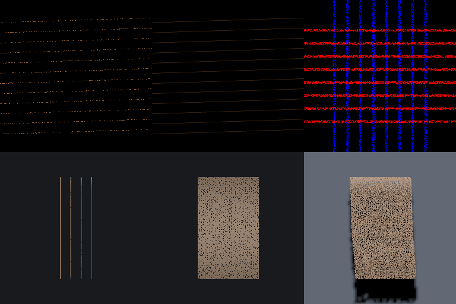

# Strand hair reference scenes and requirements (#298)

This report defines the strand-hair visual requirements that issue [#298](https://github.com/SethKitchen/ThreeMojo/issues/298) asks for, and records their measurements. The CPU rasterizer meets all thirteen requirements. The GPU rasterizer has parity tests for the same scenes. Those tests compile for `sm_80`, but no device has run them for this change.

The selected strategy stays: feathered ribbons with one stochastic coverage sample per pixel, opaque depth writes, a stochastic light depth map for cast shadows and a density volume for self-shadow. No generic order-independent transparency (OIT) pass is necessary.

## Reference scenes

`extensions/humanoid/skeleton/head/hair/reference.mojo` builds every scene. The scenes are procedural, so they add no third-party data. Each scene has an orthographic camera on +z, so one pixel has a known size in meters.

| Scene | Builder | What it shows |
|---|---|---|
| Fine silhouettes | `add_fine_silhouettes` | Twelve long fibers of one width and one opacity. Each fiber falls 0.1 m over its length, so its edges cross every pixel phase. The fibers reach past the view, so no cap is in the image. |
| Crossing strands | `add_crossing_strands` | A horizontal front layer and a vertical back layer, 0.4 m apart in depth. One wide fiber in each layer gives a square overlap. Eight fine fibers in each layer give a weave. |
| Self-shadow | `HairReferenceRig` with a front light | Four rows of long strands, 0.04 m apart in depth. Each row has 12 guides with two followers each, so 36 strands of 12 points. |
| Backlight | `HairReferenceRig` with the light directly behind | The same curtain, lit inside the narrow TT lobe of the Marschner model. |
| Moving long hair | `HairReferenceRig.advance` | The 0.4 m strands step in gusting wind against a sphere behind the curtain. The guides move, and the followers are laid from them. |
| Cast shadow | `HairReferenceRig(receiver=True)` | A shadow-receiving plane behind the curtain, and a directional light that casts a shadow. |

`examples/hair_reference.mojo` draws six panels of these scenes with the CPU rasterizer into `out/hair_reference.png`.



## Ground truth

The coverage ground truth is the same scene with `SOLID_LINE_COVERAGE` at eight times the image size. A fiber width in meters keeps the projected area the same at both sizes. `supersampled_coverage` box-filters each 8 x 8 block of solid samples and multiplies the result by the opacity. That is alpha coverage with a box filter. The stochastic image has one sample in each pixel. `coverage_samples` gives one for a pixel that differs from the background, else zero.

Two metrics compare them:

- `total_coverage_error`: the difference of the two summed coverages, over the reference sum. It shows bias.
- `block_coverage_error`: the mean absolute difference after a 16 x 16 pixel box filter, over the mean reference coverage. It shows noise at that filter size.

## Requirements and measurements

`tests/test_hair_reference_scenes.mojo` checks each requirement on a 64 x 64 image. The measured values below come from that suite's scenes on the shared 4-vCPU Intel Xeon cloud machine. The scenes are deterministic, so another machine gives the same images.

### Coverage

R1. The summed stochastic coverage must be within three binomial standard deviations of the ground truth. The limit is 3 / sqrt(N), where N is the expected number of covered samples.

R2. After the 16-pixel filter, the normalized error must be at or under 0.35 for quarter-pixel fibers, 0.25 for half-pixel fibers, 0.15 for one-pixel fibers and 0.10 for two-pixel fibers.

| Width | Opacity | Total error (R1) | Filtered error (R2) |
|---:|---:|---:|---:|
| 0.25 px | 0.35 | 0.043 | 0.313 |
| 0.25 px | 0.65 | 0.007 | 0.240 |
| 0.25 px | 1.00 | 0.021 | 0.239 |
| 0.5 px | 0.35 | 0.020 | 0.215 |
| 0.5 px | 0.65 | 0.059 | 0.135 |
| 0.5 px | 1.00 | 0.029 | 0.129 |
| 1 px | 0.35 | 0.007 | 0.138 |
| 1 px | 0.65 | 0.020 | 0.081 |
| 1 px | 1.00 | 0.035 | 0.052 |
| 2 px | 0.35 | 0.061 | 0.081 |
| 2 px | 0.65 | 0.007 | 0.050 |
| 2 px | 1.00 | 0.012 | 0.029 |

The coverage has no measurable bias. Its noise grows as the fibers become thinner and more transparent, because each pixel keeps one binary sample. There is no temporal accumulation to remove that noise.

### Transparency

R3. Where a front layer of opacity a covers a back layer of opacity b, a fraction a of the samples must show the front and (1 - a) b must show the back. The tolerance is 0.05 in a window of 784 samples, which is three standard deviations.

| Front a | Back b | Front: expected, measured | Back: expected, measured |
|---:|---:|---:|---:|
| 0.65 | 0.65 | 0.650, 0.666 | 0.228, 0.223 |
| 0.35 | 1.00 | 0.350, 0.355 | 0.650, 0.645 |
| 1.00 | 0.50 | 1.000, 1.000 | 0.000, 0.000 |

R4. Reversed submission order, a different worker count and a repeated render must give the same samples. This applies to fine silhouettes, the wide crossing layers and the weave.

### Self-shadow

R5. Under a front light, each row farther from the light must be darker.

R6. A denser volume must not make a row brighter, and must darken each row behind the first.

R7. No row can fall below `1 - HairLook.shadows` of the first row.

| Row, from the light | Mean luminance, 1.5 mm clumps | Mean luminance, 3 mm clumps |
|---:|---:|---:|
| 0 | 0.280 | 0.280 |
| 1 | 0.230 | 0.190 |
| 2 | 0.191 | 0.135 |
| 3 | 0.162 | 0.105 |

The rig gives each drawn strand a clump diameter, because each strand stands for many fibers. The density volume skips about one cell from each point, so the row nearest the light has no self-shadow.

### Backlight

R8. With the TT weight at one, a curtain lit from directly behind must be at least 1.5 times brighter than with the TT weight at zero. Under a front light the TT lobe must add less than one percent. The measured backlit gain is about 34 times. The front-lit gain is zero.

R9. The mean optical depth toward a backlight must decrease from the camera-side row to the light-side row. The measured row means are 0.622, 0.409, 0.205 and 0.

The head-facing term of the shading floors the direct light of every backlit point at `1 - HairLook.shadows`. That floor does not depend on the density. So a backlit curtain shows the TT lobe, but its rows do not darken by depth. The optical depth is correct, as R9 shows.

### Moving long hair

R10. The same steps must give the same images.

R11. Each frame must keep its covered samples within five percent of the rest pose. The measured change is less than one percent over six frames.

R12. After motion, the density volume and the shaded colors must change with the strands.

The suite also requires each moving frame to differ from the frame before it.

### Cast shadow

R13. The cast shadow must darken the receiver, and more opaque strands must darken it more. In the strip under the strand tips the summed receiver luminance is 21,547 with no cast shadow, 12,486 at opacity 0.35 and 2,418 at opacity 1.

## The selected strategy and the open-source reference

The selected visual reference is Frostbitten Hair WebGPU at `4478dd129525ff7db92978178b55f760716cbd72`, with TressFX for the guide and follower construction. [Converted assets](https://github.com/SethKitchen/ThreeMojo/wiki/Converted-assets) and `THIRD-PARTY-NOTICES.md` pin their revisions and licenses. The table compares the features that its README describes at that revision. This port does not use every feature, and it does not require every library.

| Feature | Frostbitten Hair WebGPU | ThreeMojo |
|---|---|---|
| Coverage | Analytic anti-aliasing in a tiled compute rasterizer | A one-pixel feather and one stochastic sample in each pixel. R1 and R2 measure it against a supersampled ground truth. |
| Transparency | OIT with depth bins and slices in each tile, blended front to back | Stochastic transparency with opaque depth. It is order-independent by construction (R3, R4). It has no blending, so it has noise (R2). |
| Strand shading | Kajiya-Kay, Marschner and fake multiple scattering in strand space. The TT weight is zero by default, because there are no light depth maps. | The same model and defaults. A density volume supplies the light depth, so the TT lobe can be on (R8). |
| Self-shadow | Beer-Lambert attenuation | Beer-Lambert attenuation through a rebuilt density volume (R5 to R7, R9, R12) |
| Cast shadow | A hardware-rasterized shadow map with PCF or PCSS | A stochastic strand depth map in the ordinary shadow-map path (R13) |
| Dynamics | Constraints with grids of velocity, density and wind | Constraints without grids. Guide-only stepping lays the followers. |

Two visual differences remain because of this choice. The stochastic coverage is noisier than analytic coverage at subpixel widths, and the silhouette can change from frame to frame where the projection moves. The reference avoids both with a dedicated software rasterizer. This port keeps both rasterizers' existing triangle paths.

## Order-independent transparency and #251

Issue [#251](https://github.com/SethKitchen/ThreeMojo/issues/251) added `oit_pass`, a port of three.js's weighted blended `OITPassNode`. That pass draws each order-independent draw alone and weighs the nearest fragment that it leaves at each pixel. A groom is one draw that covers itself many times, so that pass would keep one layer of hair in each pixel. Strand materials must also be opaque, so `oit_pass` never selects them. The strand path therefore does not depend on #251. A per-pixel sorted or sliced OIT for strands would be a new strand-specific path, not a change to #251.

## Both rasterizers

The CPU and GPU rasterizers share the coverage arithmetic. Both call `strand_hash_threshold` in `render/fragment_flags.mojo` through `hashed_threshold`. Both use the same feathered ribbon triangles from `Renderer.prepare_frame`, and the same shadow maps.

`tests/test_gpu.mojo` draws the reference scenes on both rasterizers and requires the same image within one byte for each channel:

- `test_both_backends_draw_hair_reference_coverage`: fine silhouettes at half a pixel and two pixels, and the wide and fine crossing layers, each in both orders
- `test_both_backends_draw_hair_reference_curtains`: the front-lit curtain, the backlit curtain and three frames of moving hair
- `test_both_backends_draw_hair_reference_cast_shadow`: the curtain over its receiver at opacity 0.35 and one, with the scene lighting and shadow maps

These tests compile with `--target-accelerator=sm_80` on a machine without a GPU. They return early without a device, and say so. **Device execution is pending.** Run `make test-gpu` on a machine with a supported GPU to execute them.

## Run it

```sh
mkdir -p .cache/hair-reference
.venv/bin/mojo build -I . --Werror -o .cache/hair-reference/suite \
  tests/test_hair_reference_scenes.mojo
python3 tools/run_suite.py --seconds 5 \
  --suite tests/test_hair_reference_scenes.mojo -- .cache/hair-reference/suite
.venv/bin/mojo run -I . examples/hair_reference.mojo out/hair_reference.png
```
